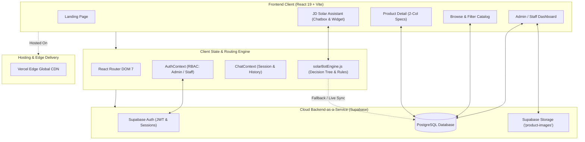
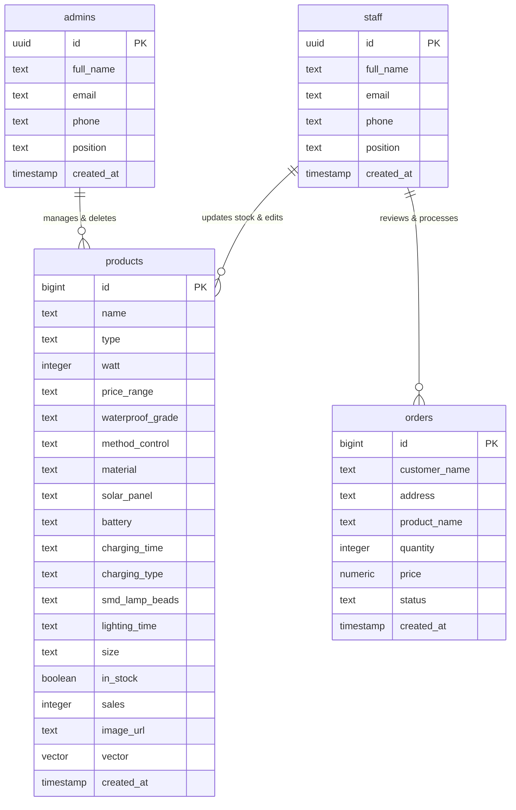
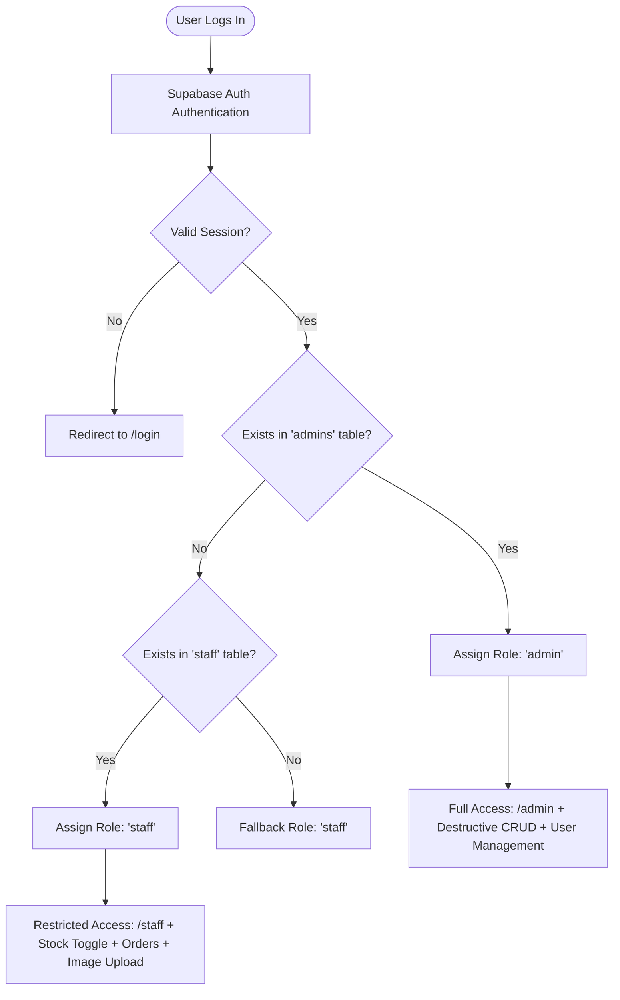

# JD Solar Digital Product Guide & Management System
## Capstone Project Comprehensive Documentation & Technical Overview

---

> [!NOTE]
> **Project Identity:** Solar App Capstone Project  
> **Industry Partner:** JD Force Solar Products Trading (Quiapo, Manila & Cavite Distribution Hub)  
> **Repository:** `Solar_App_Capstone_Project`  
> **Architecture:** Cross-Platform React 19 Jamstack + Supabase BaaS (Backend-as-a-Service) + Client-Side Decision Support Engine

---

## Table of Contents
1. [Executive Summary & Abstract](#1-executive-summary--abstract)
2. [Project Background & Industry Partner](#2-project-background--industry-partner)
3. [Statement of the Problem & Significance](#3-statement-of-the-problem--significance)
4. [Project Objectives (General & Specific)](#4-project-objectives)
5. [Scope and Delimitations](#5-scope-and-delimitations)
6. [Target Stakeholders & User Personas](#6-target-stakeholders--user-personas)
7. [System Architecture & Technology Stack](#7-system-architecture--technology-stack)
8. [Recommendation Engine & Decision Support Systems](#8-recommendation-engine--decision-support-systems)
9. [Database Schema & Data Dictionary](#9-database-schema--data-dictionary)
10. [Functional Modules & Screen Breakdown](#10-functional-modules--screen-breakdown)
11. [Security & Role-Based Access Control (RBAC)](#11-security--role-based-access-control-rbac)
12. [Capstone Defense & Viva Panel Q&A](#12-capstone-defense--viva-panel-qa)
13. [Future Scalability & Roadmap](#13-future-scalability--roadmap)

---

## 1. Executive Summary & Abstract

The **JD Solar Digital Product Guide & Management System** is a responsive, cloud-integrated web application designed to solve the critical knowledge, operational, and procurement bottlenecks faced by **JD Force Solar Products Trading**—a Philippine solar enterprise operating physical branches in Quiapo, Manila and Cavite.

In the Philippines, escalating utility rates (Meralco) and frequent grid instability have driven thousands of households, residential subdivisions, and Local Government Units (LGUs) to seek outdoor solar lighting solutions. However, commercial solar lighting products (such as aviation-grade road lights, integrated streetlights, and radar-induction floodlights) involve intricate technical specifications (wattage ratings, battery capacities in mAh, LiFePO4 chemistries, solar panel power ratings, and IP waterproof standards). Everyday consumers and community procurement officers struggle to determine which product satisfies their physical installation requirements, resulting in mismatched purchases or prolonged consultation cycles over unstructured channels like Facebook Messenger.

To address this challenge, the system introduces a **dual-purpose platform**:
1. **A Customer-Facing Digital Guide:** Provides an interactive catalog with multi-criteria filtering, a two-column technical specification breakdown, an electricity savings calculator, and **JD Solar Assistant**—an intelligent decision-support consultation engine that matches customers to suitable products based on location, illumination height, and budget.
2. **An Operational Staff & Admin Portal:** Features role-based access control (RBAC), real-time inventory stock synchronization (`in_stock` toggles), quotation lead management, and a centralized cloud storage asset manager for product imagery.

Built using **React 19**, **Vite**, **Tailwind CSS (JD Solar Design System)**, **Framer Motion**, and **Supabase (PostgreSQL, Auth, Storage)**, the application delivers a serverless, zero-maintenance, enterprise-grade user experience that streamlines customer qualification, shortens sales cycles, and empowers sustainable energy deployment.

---

## 2. Project Background & Industry Partner

### 2.1 The Founding Story
**JD Force Solar Products Trading** was founded in **2020** amidst the COVID-19 pandemic lockdowns. While traditional businesses suffered severe operational disruption, the founder recognized two urgent community realities across Metro Manila and surrounding provinces:
- Severe household financial pressure compounded by relentless monthly electricity bills (Meralco).
- Widespread unemployment and the urgent necessity for community economic empowerment.

Driven to deliver an accessible, essential, and practical solution, the founder turned to renewable solar lighting.

### 2.2 Operational Scaling & Physical Footprint
- **Phase 1 (Humble Beginnings):** Operating entirely online from residential homes, the team began by supplying 100 solar streetlights per day through grassroots community outreach and partnerships with Local Government Units (LGUs).
- **Phase 2 (Rapid Expansion):** Through consistency, direct wholesale pricing, and reliable after-sales support, distribution scaled rapidly from 500 units to **over 1,000 units sold daily**.
- **Phase 3 (Physical Hubs):** Reinvested capital enabled the establishment of two physical hubs:
  - **Quiapo Showroom (Manila):** Located in the commercial district of Quiapo, serving retail walk-ins, on-site product testing, cash pickups, and contractor consultations.
  - **Cavite Distribution Hub:** Dedicated logistics and distribution center managing bulk freight, regional deliveries, and community LGU project rollouts.

### 2.3 Business Model & Philosophy
- **B2B & LGU Wholesale Focus:** Rather than small impulse e-commerce retail, the bulk of business volume originates from residential subdivisions, commercial properties, and government community illumination projects.
- **Social Impact:** The enterprise prioritizes hiring local workers to support sustainable family livelihoods.
- **Customer Guarantee:** All units feature aviation-grade aluminum construction, monocrystalline panels, Grade-A LiFePO4 batteries, and official 1-year warranty coverage.

---

## 3. Statement of the Problem & Significance

### 3.1 Problem Statement
The operational model of JD Force Solar previously faced four significant bottlenecks:

1. **High Technical Barrier to Entry for Buyers:**
   Solar streetlights cannot be evaluated purely by aesthetics. Technical parameters such as lumen output, wattage (50W to 800W), battery capacity (15,000mAh to 91,000mAh LiFePO4), IP waterproof ratings (IP65 vs. IP67), and pole mounting heights (4m to 9m) confuse non-technical buyers. Customers frequently purchase underpowered lights for wide roadways or overpriced heavy-duty units for small residential gates.

2. **Severe Inefficiency of Unstructured Social Channels:**
   Customer inquiries were conducted almost entirely via Facebook Messenger and phone hotlines. Staff spent 70% of their working hours repeatedly answering basic, identical questions (*"Ano pong bagay sa compound?", "Ilang oras bago ma-lowbat?", "Pwede ba sa maulan?"*). This manual consultation loop created communication bottlenecks and lost sales opportunities.

3. **Incompatibility of Standard E-Commerce Checkout:**
   Commercial solar streetlights are high-ticket and bulk goods. LGUs purchasing 50 to 200 units do not use shopping carts and credit cards; they require technical qualification, formal quotations, purchase orders, and bank/corporate billing. Standard online shopping carts (Shopee/Lazada) fail to accommodate this enterprise sales flow.

4. **Inventory & Information Asymmetry:**
   Without a unified digital system, walk-in customers and remote LGU coordinators lacked real-time visibility into branch stock levels and exact physical measurements, leading to order delays and stock reconciliation errors.

### 3.2 Significance of the Project
- **For Everyday Consumers:** Democratizes solar knowledge, enables self-guided technical evaluation, and calculates concrete financial ROI (showing how a ₱0.00 electric bill replaces thousands in monthly utility costs).
- **For LGU Coordinators & Contractors:** Provides immediate access to technical specification sheets, dimensions, and direct quotation requests for public procurement.
- **For JD Solar Staff & Management:** Frees staff from repetitive spec queries, centralizes product and quotation management, provides live stock toggling, and eliminates information discrepancies between the Quiapo and Cavite branches.
- **For the Academic & Technical Field:** Demonstrates how modern web architectures (React 19, Jamstack, BaaS, client-side decision trees, and vector search) can be combined to solve real-world SME business challenges without high server overhead.

---

## 4. Project Objectives

### 4.1 General Objective
To design, implement, and deploy an end-to-end, cross-platform digital product guide, conversational decision-support assistant, and centralized management platform for **JD Force Solar Products Trading**.

### 4.2 Specific Objectives
1. **Interactive Multi-Criteria Catalog:** Develop a high-performance web catalog featuring real-time faceted search (wattage brackets, category, price range, waterproof rating, and battery capacity).
2. **Two-Column Specification Layout:** Implement standardized, clean product detail pages presenting technical parameters in an scannable, two-column bulleted layout without cluttered narrative filler.
3. **Conversational Decision Support System ("JD Solar Assistant"):** Architect an intelligent consultation chatbot providing step-by-step guidance based on installation area (roadways, subdivisions, residential gates, commercial compounds), lighting requirements, and budget constraints.
4. **Interactive Electricity Savings Module:** Embed a quantitative calculator demonstrating the cost comparison between conventional 220V grid streetlights and ₱0.00 Meralco solar lighting.
5. **Role-Based Operational Management Portal (RBAC):** Build dedicated dashboards for:
   - **Staff:** View KPIs, toggle real-time product stock availability (`in_stock`), edit specifications, process customer quotation leads, and access the image asset manager.
   - **Administrators:** Full system control, permanent product deletions, credential management for staff accounts, and security administration.
6. **Zero-DevOps Cloud Infrastructure:** Deploy the platform on serverless cloud infrastructure (Vercel + Supabase) to guarantee 99.9% uptime, zero recurring server maintenance, and fast response times across mobile and desktop devices.

---

## 5. Scope and Delimitations

### 5.1 System Scope (What the System Does)
- **Public Customer Portal:**
  - Landing page with business history, customer reviews, photo gallery, and value propositions.
  - Comprehensive About page detailing Quiapo and Cavite branch addresses, operating hours, timeline milestones, and contact channels.
  - Browse Catalog with multi-attribute filtering and responsive card layouts.
  - Product Specification screen with high-resolution imagery, two-column spec breakdown, related model suggestions, and direct quote request modal.
  - Interactive JD Solar Assistant (available both as a global floating widget and a dedicated full-screen consultation page).
- **Staff Operations Portal (`/staff`):**
  - KPI overview (product counts, in-stock counts, pending quotation requests).
  - Real-time inline product table with live stock toggle switch.
  - Structured Add Product form with validation for all solar technical attributes.
  - Inbound Quotation / Order management screen.
  - Image Asset Manager connected to Supabase Cloud Storage.
- **Administrator Management Portal (`/admin`):**
  - All staff operational features.
  - Destructive record deletion authority.
  - User and account provisioning for staff members (`admins` and `staff` tables).
  - Admin profile and credential configuration.

### 5.2 Delimitations (What the System Intentionally Excludes & Justification)
- **No Direct Credit Card / Automated E-Commerce Payment Gateway:**  
  *Justification:* JD Solar's core volume involves wholesale, B2B, and LGU bulk orders paid via bank transfer, cheque, or government disbursement vouchers. Bypassing payment gateways avoids high third-party transaction fees (2-3.5%) and aligns with their quote-to-invoice workflow.
- **No Third-Party Courier API (e.g., Lalamove/J&T Automated Dispatch):**  
  *Justification:* Heavy solar lighting fixtures (metal poles, aviation aluminum housings, high-capacity lithium battery packs) exceed standard courier limits and are dispatched via JD Solar's dedicated Cavite freight vehicles or collected via store pickup.
- **No Direct Electrical Wiring Tutorials:**  
  *Justification:* The assistant strictly guides product selection and sizing. It does not provide DIY high-voltage electrical modification instructions to prevent consumer safety and liability risks.

---

## 6. Target Stakeholders & User Personas

| Stakeholder / Persona | Role & Needs | System Interaction |
|---|---|---|
| **Residential Homeowner** | Needs perimeter/gate lighting to lower electricity bills without complex installation. | Uses the Landing Page, Browse Catalog, and JD Solar Assistant to find 50W–150W units; calculates Meralco savings. |
| **LGU Official / Barangay Chairman** | Procuring 20–100+ streetlights for public road safety within government budget allocations. | Filters catalog by 300W–600W road lights, inspects IP65/IP67 ratings, and submits formal Quotation Requests. |
| **Commercial Contractor / Developer** | Sourcing lighting for parking lots, warehouses, or private subdivisions. | Evaluates LiFePO4 battery cycle life, solar panel wattage, and requests bulk package details. |
| **Branch Staff Member (Quiapo & Cavite)** | Manages day-to-day inquiries, confirms stock on the showroom floor, and logs inbound leads. | Accesses `/staff` dashboard to toggle item availability, review customer quote requests, and upload product photos. |
| **System Administrator / Business Owner** | Oversees business operations, creates staff accounts, and maintains data integrity. | Accesses `/admin` portal for full CRUD, user management, and operational analytics. |

---

## 7. System Architecture & Technology Stack

### 7.1 Architecture Diagram

### 7.2 Technology Stack Details

#### Frontend Technologies
- **Framework:** **React 19.2** — Leverages modern component composition, concurrent rendering capabilities, and modern hooks.
- **Build Tool:** **Vite 8.0** — Fast build tool providing Hot Module Replacement (HMR) and optimized Rollup asset bundling.
- **Styling & Design Tokens:** **Tailwind CSS 3.4** — Integrated with the **JD Solar Design System (JDS)**, adopting Material Design 3 (MD3) expressive design principles:
  - Custom surface hierarchy: `jds-surface`, `jds-surface-container-low`, `jds-surface-container-high`.
  - Brand accents: `jds-primary` (solar amber/orange), `jds-secondary` (deep slate/graphite).
  - Explicit typography scale: `headline-xl`, `headline-lg`, `label-md`, `body-lg`.
  - Visual depth: `.sunlight-bg`, `.card-shadow`, `.glass-badge`, and SVG grain textures.
- **Motion & Micro-Interactions:** **Framer Motion 12.38** — Powers staggered list reveals, smooth page transitions, interactive carousels, and dialog animations.
- **Routing Engine:** **React Router DOM 7.15** — Handles deep-linking, query parameter search state (`?search=`), and role-guarded route trees.
- **State Management:** **React Context API** — Encapsulates authentication/session state ([AuthContext.jsx](file:///home/ram/Projects/Cross-platform/Solar_App_Capstone_Project/frontend/src/context/AuthContext.jsx)) and conversational guidance state ([ChatContext.jsx](file:///home/ram/Projects/Cross-platform/Solar_App_Capstone_Project/frontend/src/context/ChatContext.jsx)).
- **Icons & Typography:** `lucide-react`, `react-icons` (Heroicons `hi2`), and `@fontsource-variable/geist`.
- **Markdown Processing:** `react-markdown` — Safely parses assistant responses and dynamically converts markdown hyperlinks into in-app React Router transitions.

#### Backend-as-a-Service (Supabase Cloud Infrastructure)
- **Database Engine:** **PostgreSQL** — Relational database providing schema constraints, referential integrity, and relational views.
- **pgvector Extension:** Configured to support 2048-dimensional embeddings for semantic search matching (`match_products` RPC).
- **Authentication:** **Supabase Auth** — Issues JSON Web Tokens (JWT) with secure browser cookie/local storage persistence.
- **Object Storage:** **Supabase Storage (`product-images`)** — High-performance S3-compatible cloud bucket serving public asset URLs via CDN.

#### Deployment & Hosting
- **Vercel Edge Network:** Continuous deployment integrated with GitHub. Configured via [vercel.json](file:///home/ram/Projects/Cross-platform/Solar_App_Capstone_Project/frontend/vercel.json) to rewrite all SPA requests to `/index.html` for clean client-side routing.

---

## 8. Recommendation Engine & Decision Support Systems

The capstone project incorporates an advanced consultation module designed to guide non-technical users to the exact lighting model matching their environment.

### 8.1 The Architectural Evolution: From Python RAG to Client-Side Decision Tree

During early research and prototyping, the system utilized a Python **FastAPI** backend with **OpenRouter**, pairing `nvidia/llama-nemotron-embed-vl-1b-v2` (2048-dimensional vector embeddings) with `openai/gpt-oss-120b:free` via Retrieval-Augmented Generation (RAG). 

While technically effective, deploying a separate Python virtual machine incurred cold-start delays, third-party API rate limits, and recurring cloud hosting costs. To optimize the system for SME production, the consultation engine was refactored into a **zero-latency, client-side expert decision-support engine** ([solarBotEngine.js](file:///home/ram/Projects/Cross-platform/Solar_App_Capstone_Project/frontend/src/lib/solarBotEngine.js)) with PostgreSQL vector compatibility:

| Feature / Metric | Python FastAPI + OpenRouter RAG | Client-Side Engine (`solarBotEngine.js`) |
|---|---|---|
| **Response Latency** | 1,200ms – 3,500ms (Network + LLM stream) | **< 30ms (Instantaneous execution)** |
| **API Costs** | Ongoing token & embedding inference fees | **₱0.00 (Zero recurring API fees)** |
| **Offline / Network Fault Tolerance** | Fails completely if remote API is down | **100% resilient; uses cached catalog** |
| **Hallucination Risk** | Model could invent fictional hardware specs | **0% risk; recommendations strictly bind to real inventory** |
| **Hosting Complexity** | Requires separate Python server & reverse proxy | **Unified Jamstack bundle on Vercel** |

### 8.2 Decision-Tree Logic Flow
The assistant guides the user through three structured diagnostic steps:

1. **Step 1: Installation Area Identification**
   - *Options:* Main Roads & Thoroughfares | Subdivisions & Alleys | Residential Gates & Gardens | Commercial Facilities.
2. **Step 2: Illumination Output & Pole Height**
   - Correlates physical mounting height (e.g., 7m–9m roadway vs. 3m–4m residential gate) to required wattage (100W up to 800W).
3. **Step 3: Budget Range Specification**
   - Segments into Economy (₱1,000–₱2,000), Standard (₱2,000–₱3,500), or Heavy-Duty Industrial (₱3,500+).
4. **Resolution: Instant Curated Recommendations**
   - Filters the active Supabase inventory, extracts top candidates, and returns interactive product cards with direct deep-links to `/product/:id`.

### 8.3 Hybrid Free-Text Query Matching
When a user types open-ended queries into the assistant (e.g., *"Meron ba kayong pang-barangay na road light na hindi tinatablan ng bagyo?"*), the engine executes `matchUserQuery()`:
- Scans user input for semantic keywords: `road`, `street`, `residential`, `waterproof`, `ip67`, `battery`, `maliwanag`, `mura`.
- Evaluates catalog items against parsed attributes.
- Returns customized natural-language guidance along with matched product recommendations.

---

## 9. Database Schema & Data Dictionary

### 9.1 Entity Relationship Diagram

### 9.2 Data Dictionary

#### Table: `products`
The core catalog table storing solar lighting specifications.

| Column Name | Data Type | Nullable | Description / Example |
|---|---|---|---|
| `id` | `bigint` (Primary Key) | No | Unique identifier for the product. |
| `name` | `text` | No | Full commercial product title (e.g., *"Aviation Aluminum Solar Road Light 300W"*). |
| `type` | `text` | Yes | Category classification (e.g., *"Aviation Aluminum Solar Road Light"*). |
| `watt` | `integer` | Yes | Rated electrical power consumption / illumination equivalent in Watts. |
| `price_range` | `text` | Yes | Commercial bracket (e.g., `"1000-2000"`, `"2500-3500"`, `"3000+"`). |
| `waterproof_grade` | `text` | Yes | Ingress Protection rating (`IP65`, `IP67`). |
| `method_control` | `text` | Yes | Control interfaces (e.g., *"Light Control + Remote Control + Radar Sensor"*). |
| `material` | `text` | Yes | Chassis composition (e.g., *"Aviation Aluminum + Optical Lens"*). |
| `solar_panel` | `text` | Yes | Photovoltaic panel specifications (e.g., *"Monocrystalline silicon (5V/55W)"*). |
| `battery` | `text` | Yes | Battery pack details (e.g., *"58500mAh Lithium Iron Phosphate Battery"*). |
| `charging_time` | `text` | Yes | Required direct sunlight duration (e.g., *"4~6 hours"*). |
| `charging_type` | `text` | Yes | Power source (e.g., *"Solar Charging"*). |
| `smd_lamp_beads` | `text` | Yes | LED emitter array (e.g., *"Sanan chip 180 pcs 5054 LED"*). |
| `lighting_time` | `text` | Yes | Continuous night discharge span (e.g., *"12~16 hours"*). |
| `size` | `text` | Yes | Physical dimensions in mm (e.g., *"805mm x 240mm x 70mm"*). |
| `in_stock` | `boolean` | No | Live availability indicator (toggled by branch staff). |
| `sales` | `integer` | Yes | Historical sales count for sorting and popularity metrics. |
| `image_url` | `text` | Yes | Public HTTPS URL hosted in Supabase Storage. |
| `vector` | `vector(2048)` | Yes | Dense mathematical vector for pgvector semantic search. |

#### Table: `admins` & `staff`
Dedicated identity and authorization tables linked to `auth.users.id`.

| Column Name | Data Type | Description |
|---|---|---|
| `id` | `uuid` (Primary Key) | Foreign Key referencing Supabase `auth.users.id`. |
| `full_name` | `text` | Name of the staff member or administrator. |
| `email` | `text` | Official login email address. |
| `phone` | `text` | Contact telephone number. |
| `position` | `text` | Job title (e.g., *"Administrator"*, *"Quiapo Branch Staff"*). |
| `created_at` | `timestamptz` | Account provisioning timestamp. |

#### Table: `orders` (Quotation Leads)
Captures quotation and inquiry requests submitted by prospective buyers.

| Column Name | Data Type | Description |
|---|---|---|
| `id` | `bigint` (Primary Key) | Unique inquiry record identifier. |
| `customer_name` | `text` | Name of client, contractor, or LGU representative. |
| `address` | `text` | Delivery location or project installation site. |
| `product_name` | `text` | Inquired solar lighting model. |
| `quantity` | `integer` | Desired order volume. |
| `price` | `numeric` | Estimated quote unit or aggregate price. |
| `status` | `text` | Lifecycle state (`Pending`, `Contacted`, `Completed`). |
| `created_at` | `timestamptz` | Submission timestamp. |

---

## 10. Functional Modules & Screen Breakdown

### 10.1 Customer-Facing Experience

#### 1. Landing Page ([LandingPage.jsx](file:///home/ram/Projects/Cross-platform/Solar_App_Capstone_Project/frontend/src/pages/LandingPage.jsx))
- **Hero Presentation:** High-impact visual headline highlighting sustainable lighting from Quiapo, Manila across the Philippines.
- **Impact Metrics:** Highlights years of service, thousands of families supported, dual branch operations, and estimated carbon footprint reduction.
- **Customer Reviews Carousel:** Displays real client feedback from Google Maps and Facebook verifying after-sales quality and installation support.
- **Installation Photo Gallery:** Interactive scrollable gallery showcasing residential, commercial, and roadway solar streetlight installations across the country.

#### 2. About & Branch Directory ([AboutPage.jsx](file:///home/ram/Projects/Cross-platform/Solar_App_Capstone_Project/frontend/src/pages/AboutPage.jsx))
- **Founding Narrative:** Recounts the enterprise's origins during the pandemic and its mission to mitigate utility costs.
- **Mission, Vision, and Values:** Details corporate commitments to resilience, community empowerment, honest pricing, and sustainable livelihoods.
- **Physical Branch Cards:** Provides exact addresses, operating hours, walk-in services, and Google Maps links for both the **Quiapo Showroom** and **Cavite Logistics Hub**.
- **Historical Timeline:** Highlights milestones from the 2020 founding to modern multi-branch distribution.

#### 3. Product Catalog & Filter Hub ([BrowsePage.jsx](file:///home/ram/Projects/Cross-platform/Solar_App_Capstone_Project/frontend/src/pages/BrowsePage.jsx))
- **Instant Search:** Dynamic query matching against titles and descriptions with synchronized URL state (`?search=`).
- **Faceted Filters:**
  - *Category Tabs:* Quick category switching (Aviation Road Lights, Integrated Streetlights, Aluminum Lights).
  - *Power Output Brackets:* Under 200W, 200W–400W, Above 400W.
  - *Waterproof Rating:* All, IP65, IP67.
  - *Price Slider:* Real-time filtering up to ₱50,000+.
- **Stock Badging:** Real-time visual indicators displaying whether units are *In Stock* or *Out of Stock*.

#### 4. Product Detail & Specification Sheet ([ProductInfoPage.jsx](file:///home/ram/Projects/Cross-platform/Solar_App_Capstone_Project/frontend/src/pages/ProductInfoPage.jsx))
- **High-Resolution Photography:** Dynamic image display with zoom capabilities.
- **Two-Column Specification Grid:** In accordance with capstone guidelines, narrative fluff was replaced with an uncluttered, high-density two-column bulleted spec grid displaying:
  - Price Range, Power Output (Watts), Ingress Protection (IP Rating)
  - Control Method (Light + Radar Sensor), Chassis Material
  - Solar Panel Type (Monocrystalline Silicon), Battery Capacity & Chemistry
  - Charging Time, Lighting Duration, SMD Lamp Bead Array, Physical Dimensions
- **Direct Action Workflows:**
  - *"Ask SolarAI About This"* button: Immediately opens the consultation assistant pre-loaded with the active product context.
  - *"Request Quote"* modal: Enables one-click lead submission for bulk and retail orders.

#### 5. JD Solar Assistant & Chatbot ([ChatboxPage.jsx](file:///home/ram/Projects/Cross-platform/Solar_App_Capstone_Project/frontend/src/pages/ChatboxPage.jsx) & [ChatWidget.jsx](file:///home/ram/Projects/Cross-platform/Solar_App_Capstone_Project/frontend/src/components/ChatWidget.jsx))
- **Interactive Multi-Step Consultation:** Diagnoses user needs through guided button menus.
- **Electricity Savings Calculator:** Presents a quantitative comparative analysis showing annual Meralco grid lighting expenditures (~₱7,800/yr per 150W fixture) versus the ₱0.00 operating cost of JD Solar hardware.
- **Warranty & Branch Advice:** Explains 1-year warranty policies, replacement protocols, and branch testing hours.

---

### 10.2 Administrative & Operational Experience

#### 1. Role-Guarded Access ([LoginPage.jsx](file:///home/ram/Projects/Cross-platform/Solar_App_Capstone_Project/frontend/src/pages/LoginPage.jsx) & [ProtectedRoute.jsx](file:///home/ram/Projects/Cross-platform/Solar_App_Capstone_Project/frontend/src/components/ProtectedRoute.jsx))
- Authenticates users via Supabase Auth.
- Automatically resolves permissions via [AuthContext.jsx](file:///home/ram/Projects/Cross-platform/Solar_App_Capstone_Project/frontend/src/context/AuthContext.jsx) by checking `admins` first, then `staff`.
- Redirects authorized personnel to their respective management suites while barring public visitors.

#### 2. Staff Management Dashboard (`/staff`) ([StaffPage.jsx](file:///home/ram/Projects/Cross-platform/Solar_App_Capstone_Project/frontend/src/pages/StaffPage.jsx))
- **Dashboard Screen:** Real-time KPI summary (total products, active stock count, total orders).
- **Products Screen ([ProductsScreen.jsx](file:///home/ram/Projects/Cross-platform/Solar_App_Capstone_Project/frontend/src/components/admin/ProductsScreen.jsx)):** Displays the catalog in an interactive table. Staff can perform inline attribute updates and toggle the `in_stock` switch to instantly update customer-facing catalog visibility. Product deletion is disabled for staff to prevent accidental data loss.
- **Add Product Screen ([AddProductScreen.jsx](file:///home/ram/Projects/Cross-platform/Solar_App_Capstone_Project/frontend/src/components/admin/AddProductScreen.jsx)):** Form with field-level validation for new inventory ingestion.
- **Orders Screen ([OrdersScreen.jsx](file:///home/ram/Projects/Cross-platform/Solar_App_Capstone_Project/frontend/src/components/admin/OrdersScreen.jsx)):** Tracks customer quotation requests, order quantities, customer addresses, and order fulfillment statuses (`Pending`, `Processed`).
- **Images Screen ([ImagesScreen.jsx](file:///home/ram/Projects/Cross-platform/Solar_App_Capstone_Project/frontend/src/components/admin/ImagesScreen.jsx)):** Direct asset manager connected to Supabase Cloud Storage. Staff can drag-and-drop new product photos, preview dimensions, copy CDN URLs, and inspect storage utilization.

#### 3. Administrator Control Center (`/admin`) ([AdminPage.jsx](file:///home/ram/Projects/Cross-platform/Solar_App_Capstone_Project/frontend/src/pages/AdminPage.jsx))
- Incorporates all staff operational views.
- **Destructive Deletion Rights:** Admin accounts retain exclusive permissions to permanently delete products from the database.
- **User Provisioning ([UsersScreen.jsx](file:///home/ram/Projects/Cross-platform/Solar_App_Capstone_Project/frontend/src/components/admin/UsersScreen.jsx)):** Allows administrators to register new staff accounts, assign branches, reset credentials, and audit administrative privileges.
- **Profile Management ([ProfileScreen.jsx](file:///home/ram/Projects/Cross-platform/Solar_App_Capstone_Project/frontend/src/components/admin/ProfileScreen.jsx)):** Allows administrators to update profile credentials and security keys.

---

## 11. Security & Role-Based Access Control (RBAC)

1. **Authentication Token Management:** User sessions are verified using secure JSON Web Tokens (JWT) handled by Supabase Auth with automated token refresh.
2. **Context-Driven Route Guarding:** The client implements [ProtectedRoute.jsx](file:///home/ram/Projects/Cross-platform/Solar_App_Capstone_Project/frontend/src/components/ProtectedRoute.jsx) which checks the user's role before rendering sensitive components. If an unauthorized user navigates directly to `/admin`, the system intercepts the request and redirects them.
3. **Database Privilege Segregation:** Admins and staff are isolated into separate relational tables (`admins` and `staff`). Even if a staff member attempts to manually send a delete request to the `products` table, application-level role checks prevent execution.
4. **Environment Isolation:** Public environment files expose only `VITE_SUPABASE_URL` and `VITE_SUPABASE_ANON_KEY`. Administrative master keys (`SERVICE_ROLE_KEY`) are kept out of client bundles to protect data integrity.

---

## 12. Capstone Defense & Viva Panel Q&A

This section provides technical and business answers to anticipated panelist questions during capstone oral examinations and thesis defenses:

### Q1: "Why shouldn't the panel view this as just another standard e-commerce store like Shopee or Lazada?"
**Defense Answer:**  
Standard consumer e-commerce platforms are built for low-ticket impulse goods (clothing, phone accessories) using automated credit card checkouts and third-party parcel shipping. 

JD Solar's core business involves heavy, high-ticket renewable infrastructure (aviation aluminum streetlights and LiFePO4 batteries weighing 15–30kg per set) frequently ordered in bulk quantities (20 to 200+ units) by Local Government Units (LGUs), private subdivisions, and commercial facilities. These entities require formal procurement steps: technical validation, compliance with pole height and illumination engineering requirements, formal quotation sheets, and invoicing for government audit purposes. This platform serves as a specialized **Digital Product Guide & Decision Support System** that streamlines the pre-sale consultation and qualification pipeline, addressing an enterprise-level B2B and institutional procurement flow that generic retail shopping apps cannot accommodate.

---

### Q2: "Why is there no integrated online payment gateway (credit card/GCash checkout) in the system?"
**Defense Answer:**  
The omission of an automated retail payment gateway is an intentional architectural decision based on the business reality of our industry partner:
1. **Transaction Surcharges:** Standard payment gateways levy 2.5% to 3.5% transaction fees. On a ₱350,000 barangay roadway procurement order, fees would deduct over ₱10,000 in unnecessary operational costs.
2. **Institutional Payment Mechanisms:** Government and corporate procurement laws prohibit checking out bulk municipal hardware via personal credit cards; payments are processed via corporate bank wire, manager's check, or LGU disbursement vouchers.
3. **Lead Qualification:** The system's purpose is to automate lead qualification. The customer selects the specifications, reviews the two-column spec sheet, and submits a structured quotation inquiry. The Quiapo or Cavite branch staff then issues an official quotation, accelerating closing without third-party fees.

---

### Q3: "How does the recommendation engine differ from a standard dropdown filter?"
**Defense Answer:**  
While the application does include faceted dropdown filters for experienced buyers who already understand technical terms, the **JD Solar Assistant** addresses the broader market of non-technical buyers. 

A traditional dropdown filter requires the user to already know that they need *"IP67 waterproof rating, 300W output, and 58,500mAh LiFePO4 capacity."* Non-technical buyers do not know these terms; they know their real-world problem: *"I need a light for an unlit community road on 7-meter poles that won't fail during typhoons."* 

Our decision-support engine maps intuitive, environmental constraints (location type, physical mounting height, and budget) directly to the necessary engineering attributes. Additionally, the system includes hybrid natural-language keyword parsing and a pre-configured 2048-dimensional vector embedding architecture (`pgvector`), bridging human intent with technical specifications.

---

### Q4: "How does the system ensure safety and prevent AI liability regarding electrical advice?"
**Defense Answer:**  
A common risk with open-ended LLMs is hallucination or providing dangerous, unverified electrical wiring advice. The JD Solar platform mitigates this through **strict architectural bounding**:
1. The assistant operates on deterministic, expert-validated decision trees and strict product context rules.
2. The bot is scoped exclusively to product selection, dimensional sizing, illumination suitability, and branch inquiries.
3. The platform intentionally excludes high-voltage domestic grid wiring advice, directing clients to visit the Quiapo showroom or consult certified electricians for complex physical pole installations.

---

### Q5: "How does inventory stay synchronized between the physical branches and the digital catalog?"
**Defense Answer:**  
Inventory synchronization is handled through the dedicated staff management portal. Both the Quiapo showroom and Cavite logistics hub have authorized staff access to `/staff`. When an item's floor stock is exhausted or reserved for an LGU project, the on-duty staff member navigates to the Products screen and toggles the `in_stock` switch. 

Because the frontend is connected directly to Supabase's PostgreSQL database, this change reflects immediately across the customer catalog and the decision-support engine. Items marked out of stock display a prominent *"Out of Stock"* badge and are filtered out of automated recommendations to prevent unfulfillable customer inquiries.

---

### Q6: "Why choose React 19 and Supabase instead of a traditional full-stack framework like Laravel or Django?"
**Defense Answer:**  
This architectural decision prioritized **operational longevity and zero-maintenance reliability for the SME partner**:
1. **Zero-DevOps Maintenance:** A traditional Django or Laravel monolithic deployment requires provisioning a dedicated virtual private server (VPS), configuring Nginx reverse proxies, managing Linux security patches, and manually tuning database daemons. JD Solar does not employ a dedicated full-time systems administrator.
2. **Managed Cloud Infrastructure:** Supabase provides fully managed PostgreSQL with automated daily backups, built-in connection pooling, scalable object storage, and managed authentication.
3. **Decoupled Client Speed:** Pairing React 19 with Vite delivers a static client bundle deployed across Vercel's global Edge CDN, ensuring instantaneous page loads even on constrained mobile connections across regional provinces.

---

## 13. Future Scalability & Roadmap

1. **Automated PDF Quotation Generator:**  
   Implement a client-side or serverless edge function that generates downloadable, formatted PDF quotation sheets complete with JD Solar's official header, Quiapo/Cavite branch contact numbers, full two-column specifications, and formal signature lines for LGU procurement bidding.
2. **SMS & Viber Webhook Notifications:**  
   Integrate Twilio or Semaphore SMS APIs to immediately notify branch staff on their mobile phones whenever a high-volume quotation request is submitted.
3. **Solar PV Sizing Calculator:**  
   Expand the savings calculator into an engineering sizing tool where customers input their monthly Meralco kWh consumption and roof dimensions to calculate exact photovoltaic panel requirements and estimated payback periods.
4. **Multi-Branch Inventory Partitioning:**  
   Enhance the `products` table schema to track separate stock quantities for the **Quiapo Showroom** versus the **Cavite Logistics Hub**, allowing customers to select their preferred pickup or dispatch location.

---

*Document compiled for the Capstone Project Defense & Technical Archive.*  
*Solar App Capstone Project — JD Force Solar Products Trading.*
