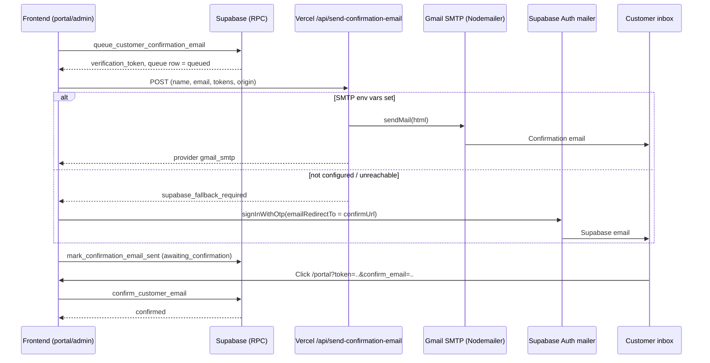
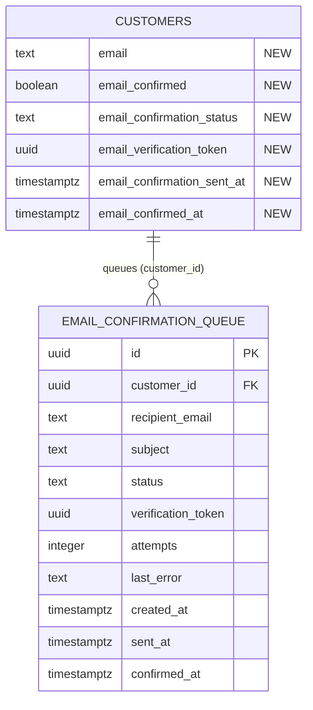

# Customer Email Confirmation System (Vercel Serverless, Nodemailer, Supabase)

Source: commit `b67b7af` ("require customer email and implement account creation confirmation workflow"). This document separates what existed before from what was added.

## 1. Summary

| Area | Before | After (added) |
|---|---|---|
| Customer email | Stored only in `customer_passwords.email`, optional | Required; stored on `customers` with confirmation lifecycle |
| Email delivery | None | Vercel Serverless Function using Nodemailer (Gmail/custom SMTP), with Supabase Auth mailer fallback |
| Confirmation | None | One-click link `/portal?token=...&confirm_email=...` |
| Tracking | None | `email_confirmation_queue` table plus status columns |
| Hosting config | Frontend-only SPA rewrite in `frontend/vercel.json` | Root `vercel.json` with build command, `/api/*` rewrite; `/api` function entry |

## 2. Old system (before)

### Tables
`auth.users`, `admins`, `staff`, `categories`, `products`, `quote_tickets`, `customers`, `customer_purchases`, `warranty_claims`, `customer_passwords`.

`customers` (old): `id, phone_number, full_name, access_token, province, city, ..., facebook, created_at`. No email columns.

### Old RPC functions (SQL migrations)
| Function | Migration | Purpose |
|---|---|---|
| `set_customer_password(token, email, password, current_password)` | `customer_passwords_migration.sql` | Hash (bcrypt via pgcrypto) and upsert credentials; email only in `customer_passwords` |
| `customer_login(email, password)` | `customer_passwords_migration.sql` | Email/password login |
| `get_customer_auth_status(token)` | `customer_passwords_migration.sql` | Returns `has_password`, `email` |
| `delete_customer_account`, `delete_platform_user` | `account_deletion_migration.sql` | Account removal |
| `purge_inactive_quote_tickets` | `purge_inactive_quote_tickets_migration.sql` | Cleanup |

### Old frontend
Customer registration/sale, portal login via QR token or password. No email sending. Single SPA rewrite in `frontend/vercel.json`.

## 3. New (added) components

### 3.1 Database: `docs/database/migrations/customer_email_confirmation_migration.sql`
Run manually in the Supabase SQL Editor.

**New columns on `public.customers`**: `email`, `email_confirmed` (default false), `email_confirmation_status` (default `queued`), `email_verification_token` (UUID, default `gen_random_uuid()`), `email_confirmation_sent_at`, `email_confirmed_at`. Indexes: `idx_customers_email` (on `LOWER(email)`), `idx_customers_verification_token`. Existing emails are backfilled from `customer_passwords`.

**New table `public.email_confirmation_queue`** (as created by the migration):
`id, customer_id (FK customers, ON DELETE CASCADE), recipient_email, subject, status (queued | awaiting_confirmation | confirmed | failed), verification_token, attempts, last_error, created_at, sent_at, confirmed_at`.
RLS: authenticated (staff/admin) full access; anon `SELECT` denied (access only through RPCs).

**New RPCs** (all `SECURITY DEFINER`, `search_path = ''`, granted to `anon, authenticated`):
| Function | Behavior |
|---|---|
| `queue_customer_confirmation_email(p_customer_id, p_email)` | Validates email, sets `customers.email`, resets to unconfirmed/`queued`, issues a new verification token, inserts a queue row (attempts = 1). Returns `queue_id`, `access_token`, `verification_token` |
| `mark_confirmation_email_sent(p_customer_id, p_status, p_error)` | Sets status (default `awaiting_confirmation`) on the customer and on `queued`/`failed` queue rows; stamps `sent_at` |
| `confirm_customer_email(p_token, p_verification_token)` | Finds customer by access token; rejects mismatched verification token; sets `email_confirmed = true`, status `confirmed`, timestamps; updates queue |

**Modified RPCs** (replaced via `CREATE OR REPLACE`):
| Function | Change |
|---|---|
| `get_customer_auth_status(token)` | Now also returns `email_confirmed`, `email_confirmation_status`, `email_verification_token`, `email_confirmation_sent_at`, `email_confirmed_at`; email falls back from `customers.email` to `customer_passwords.email` |
| `set_customer_password(...)` | Syncs email into `customers`; if the email changed, resets confirmation to `queued` with a new token and returns `email_changed` and `email_confirmed` |

### 3.2 Vercel Serverless Function
- Implementation: `frontend/api/send-confirmation-email.js`
- Entry re-export: `api/send-confirmation-email.js` (`export { default } from '../frontend/api/send-confirmation-email.js'`), so Vercel picks it up from the repo root.
- Dependency: `nodemailer` (`^10.5.0`) added to `frontend/package.json`.
- `POST /api/send-confirmation-email`; `OPTIONS` returns 200 (CORS `*`); other methods return 405.
- Request body: `customerName, email, phoneNumber, branchLocation, accessToken, verificationToken, origin` (client also sends `customerId`, unused server-side).
- Validation: `email` must be present and contain `@`, otherwise 400.
- Builds:
  - `portalUrl = {origin | PUBLIC_SITE_URL | https://jdforcesolar.com}/portal?token=<accessToken>`
  - `confirmUrl = portalUrl&confirm_email=<verificationToken>` (or `=1` if no token)
- HTML body built by `buildConfirmationEmailHtml` (all values passed through `escapeHtml`; no emojis, per project rules). Subject: `JD Force Solar - Account Created & Email Confirmation Required`.
- Transport logic:
  1. If SMTP user and password are configured, send via Nodemailer. Response: `{ success: true, provider: 'gmail_smtp', messageId, status: 'awaiting_confirmation', confirmUrl }`.
  2. Otherwise return `{ success: true, provider: 'supabase_fallback_required', ... }` to tell the client to use the Supabase mailer.
  3. Exceptions return 500 `{ success: false, error }`.

### 3.3 SMTP configuration (Vercel environment variables)
| Variable | Notes |
|---|---|
| `GMAIL_USER` or `SMTP_USER` | Sender account (surrounding quotes trimmed) |
| `GMAIL_APP_PASSWORD` or `SMTP_PASS` | Gmail App Password (whitespace and quotes stripped) |
| `SMTP_HOST` | Default `smtp.gmail.com` |
| `SMTP_PORT` | Default `465` (TLS `secure` only when 465) |
| `PUBLIC_SITE_URL` | Fallback site origin when the request has none |

`frontend/.env.example` documents `GMAIL_USER` and `GMAIL_APP_PASSWORD` (optional). Set secrets in the Vercel dashboard only, never `VITE_`-prefixed. Gmail requires 2-Step Verification to create an App Password.

### 3.4 Supabase Auth email (fallback)
If the function reports `supabase_fallback_required`, is unreachable (e.g. local `vite` dev), or returns non-OK, the client calls `supabase.auth.signInWithOtp({ email, options: { emailRedirectTo: confirmUrl, data: {...} } })`. The email then comes from Supabase's built-in mailer and uses the Supabase email template, which is separate from the custom HTML. Supabase's default mailer has strict rate limits and (without custom SMTP) delivers only to team members, so Nodemailer is the primary path. This also creates an `auth.users` OTP user as a side effect.

### 3.5 Hosting config
- New root `vercel.json`: `buildCommand` (`npm --prefix frontend install && npm run build --prefix frontend`), `outputDirectory: frontend/dist`, rewrites `/api/*` to functions and everything else to `/index.html`.
- `frontend/vercel.json` updated with the `/api/` rewrite exclusion.

### 3.6 Frontend (`frontend/src/lib/customerService.js`)
| Function | Status | Role |
|---|---|---|
| `queueAndSendCustomerConfirmationEmail` | New | Orchestrates queue RPC, serverless dispatch, Supabase fallback, `mark_confirmation_email_sent`; reports status via `onStatusChange` |
| `confirmCustomerEmailByToken` | New | Calls `confirm_customer_email` RPC, with direct table-update fallback |
| `readLocalEmailState` / `writeLocalEmailState` | New (internal) | localStorage cache `jd_cust_email_state_<token>` |
| `getCustomerAuthStatus`, `setCustomerPassword`, `registerCustomerAndSale`, `fetchCustomerPortalData`, `fetchAllCustomers` | Modified | Carry email and confirmation fields |

Callers: `QRReceiptModal`, `CustomersScreen` (admin resend), `CustomerPortalPage` (auto-confirm from `?confirm_email=` and resend), `RegisterSaleScreen`, `QuoteModal`, `InquiriesScreen` (email now required). Tests: `__tests__/CustomerEmailConfirmation.test.jsx`.

## 4. Flow

Status lifecycle: `queued` -> `awaiting_confirmation` -> `confirmed` (or `failed`). Changing the email resets to `queued` with a fresh token.

## 5. Updated ERD (changes only)

## 6. Known issues and notes

- **ERD mismatch (fixed)**: `docs/database_erd.md` listed `EMAIL_CONFIRMATION_QUEUE` with columns that did not exist in the migration. Changes made to the ERD: removed `customer_name`, `phone_number`, `branch_location`, `access_token`; renamed `error_message` to `last_error` and `queued_at` to `created_at`; added `subject` and `attempts`. It now matches the migration.
- The Supabase fallback path cannot show the custom HTML and marks `awaiting_confirmation` even if delivery silently fails; `failed` status is currently never set by the client.
- `confirm_customer_email` accepts a null verification token (e.g. `confirm_email=1`), so the access token alone can confirm. Consider requiring the verification token.
- The function sets CORS `*` and has no rate limiting or auth, so it can be used to send mail to arbitrary addresses. Consider an origin allow-list and throttling.
- The queue RLS policy for `authenticated` is `USING (true)`; customers are anon (token-based), so this only affects staff/admin.
- `frontend/.env.example` contains a real-looking Supabase URL/publishable key; publishable keys are public by design, but confirm no secrets are committed.
- The migration must be run manually; the client has fallbacks if it has not been applied.

