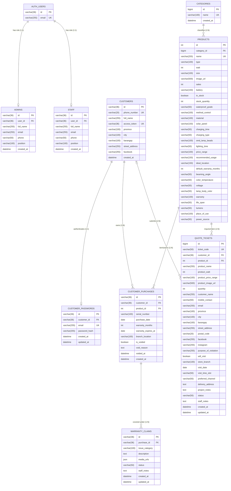
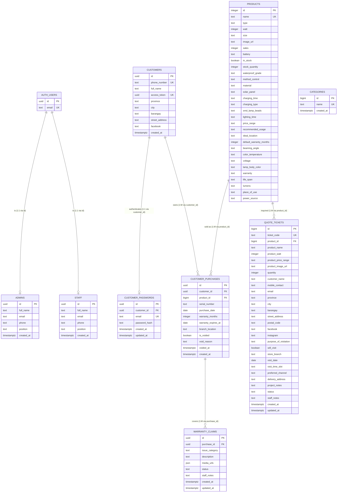

# JD Solar Platform: Database Architecture, Comparative Analysis, and Academic Defense Guide

**Document Metadata:**
* **Project:** JD Solar: A Rule-based Multi-Criteria Product Matching and Fault Diagnostic E-commerce System for Off-Grid Solar Lighting
* **Institution:** National Teachers College, School of Arts, Science and Technology
* **Degree Program:** Bachelor of Science in Information Technology
* **Scope:** Relational vs. Non-Relational Analysis, PostgreSQL vs. MySQL Comparative Evaluation, Dual ERD Architecture, and Defense Defense Strategy

---

## 1. Executive Summary and Strategic Recommendation

### 1.1 The Strategic Dilemma
In academic evaluation, panelists frequently evaluate database designs using traditional MySQL and textbook 3rd Normal Form (3NF) relational models taught in foundational computing curricula. Concurrently, modern cloud development leverages managed PostgreSQL platforms such as Supabase, utilizing Object-Relational Database Management System (ORDBMS) primitives, native UUIDs, arrays, and Row Level Security (RLS).

When panelists examine modern implementations without seeing textbook foreign key notations or see denormalized attributes, they frequently question whether referential integrity is enforced.

### 1.2 The Recommended Solution: Dual-Layer Documentation Strategy

```
+-------------------------------------------------------------------------------+
|                      ACADEMIC MANUSCRIPT & ORAL DEFENSE                       |
+-------------------------------------------------------------------------------+
                                        |
       +--------------------------------+--------------------------------+
       |                                                                 |
       v                                                                 v
+-------------------------------+               +--------------------------------+
| MAIN CHAPTER 4 BODY           |               | TECHNICAL APPENDIX / ANNEX     |
| (Figure 19 & Section 4.3.5)   |               | (Physical Cloud Architecture)  |
+-------------------------------+               +--------------------------------+
| - Standard ANSI SQL / MySQL   |               | - PostgreSQL / Supabase Engine |
|   relational notation         |               | - UUID primary keys            |
| - Standard scalar types       |               | - Native JSON/JSONB media      |
|   (INT, VARCHAR, DATETIME)    |               | - Row Level Security policies  |
| - Explicit PK-to-FK links     |               | - Realtime Write-Ahead Log     |
| - 100% compliant with 3NF     |               | - Exact live code mapping      |
+-------------------------------+               +--------------------------------+
```

1. **Main Manuscript (Chapter 4, Section 4.3.4 & 4.3.5):**
   * Present the standard ANSI SQL Relational ERD. Use standard scalar data types (`INT`, `BIGINT`, `VARCHAR`, `DECIMAL`, `DATETIME`).
   * Show every relationship strictly connecting Primary Key (`id`) to Foreign Key (`_id`).
   * Remove the obsolete, unlinked `orders` table to strictly align with the project's approved delimitation: *"The application does not support online payment or transaction processing; all purchases are completed through a walk-in visit to the physical store."*
2. **Technical Appendix / Supplementary Section:**
   * Present the physical PostgreSQL / Supabase implementation schema.
   * Document how PostgreSQL ORDBMS capabilities (native UUIDs, `jsonb`, and Row Level Security) satisfy enterprise security and scalability requirements.

---

## 2. Relational (RDBMS) vs. Non-Relational (NoSQL) Databases

### 2.1 Theoretical Foundations

| Evaluation Criterion | Relational Databases (RDBMS)<br>*(MySQL, PostgreSQL, Supabase)* | Non-Relational Databases (NoSQL)<br>*(MongoDB, CouchDB, DynamoDB)* |
| :--- | :--- | :--- |
| **Data Model** | Tabular: Relations consisting of rows (tuples) and columns (attributes) governed by a strict mathematical schema. | Document-oriented (JSON/BSON), Key-Value, Columnar, or Graph stores. |
| **Integrity Model** | **ACID Guarantees:**<br>- **A**tomicity: All-or-nothing transactions.<br>- **C**onsistency: Rules and constraints never violated.<br>- **I**solation: Concurrent operations do not collide.<br>- **D**urability: Committed data survives hardware failure. | **BASE Model:**<br>- **B**asically **A**vailable<br>- **S**oft-state<br>- **E**ventual consistency |
| **Referential Integrity** | Enforced at the database engine level via Primary Key (`PK`) and Foreign Key (`FK`) constraints with cascade rules. | Handled manually in application-level business logic; no foreign key constraints enforced by the engine. |
| **Schema Flexibility** | Fixed, pre-defined schema requiring explicit DDL migrations (`ALTER TABLE`). | Dynamic, schema-less; fields can vary from document to document within the same collection. |
| **Query Mechanism** | Structured Query Language (SQL) utilizing relational algebra and set theory (`JOIN`, `GROUP BY`, `HAVING`). | Object-oriented API or proprietary query syntax (e.g., MQL: `db.collection.find()`). |

### 2.2 Justification for Relational Architecture in the JD Solar System

A small off-grid solar equipment business requires strict referential integrity. A non-relational document database (e.g., MongoDB) would introduce critical business vulnerabilities:

1. **Serialized Warranty and Asset Tracking:**
   * In off-grid solar installations, each luminaire has a manufacturer serial number, warranty term, and expiration date.
   * In a relational database, `CUSTOMER_PURCHASES` binds the customer entity and product entity with a strict `FOREIGN KEY` constraint. If an administrator deletes or renames a product, the database prevents accidental loss of historical purchase records (`ON DELETE RESTRICT`).
   * In NoSQL, unlinked documents lead to orphaned warranties and mismatched customer serial records.
2. **Consultative Lead Inquiries (O2O Workflow):**
   * Prospective buyers request quotations through guided button surveys. The inquiry ticket must link directly to verified catalog hardware specifications (`products.id`).
   * A relational schema guarantees that technical specifications (wattage, battery capacity, lumen output) are single sources of truth, preventing catalog duplication.

---

## 3. PostgreSQL vs. MySQL: Technical Analysis

### 3.1 Architectural Distinctions

MySQL and PostgreSQL are both open-source SQL relational database management systems, but they are architecturally different in standard compliance and object support:

* **MySQL (Pure RDBMS):** Developed with a focus on high-speed web read operations (LAMP stack). It adheres to core relational principles but historically prioritized read performance over strict standard compliance.
* **PostgreSQL (Object-Relational DBMS / ORDBMS):** Designed with an emphasis on strict ANSI SQL standard compliance, enterprise extensibility, and complex data structures. It supports object-oriented database features, including table inheritance, user-defined functions, complex composite types, and array attributes.

### 3.2 Feature-by-Feature Comparison

```
+---------------------------+-----------------------------------+-----------------------------------+
| Feature Matrix            | MySQL (Standard 8.0)              | PostgreSQL 15+ (via Supabase)     |
+---------------------------+-----------------------------------+-----------------------------------+
| Primary Architecture      | RDBMS (Relational)                | ORDBMS (Object-Relational)        |
| Standard Compliance       | Partial ANSI SQL compliance       | Rigorous ANSI SQL:2023 compliance |
| Native UUID Support       | Stored as BINARY(16) or CHAR(36)  | First-class native UUID type      |
| Array Column Support      | Unsupported (Requires 1:N table)  | Native Array types (e.g. TEXT[])  |
| JSON Processing           | JSON text validation              | Binary JSON (JSONB) with GIN indexing|
| Row-Level Security (RLS)  | Manual application middleware     | Engine-level policy enforcement   |
| Realtime Event Engine     | External tools (Debezium/Kafka)   | Native Write-Ahead Log (WAL) pipe |
| Stored Procedures         | Procedural SQL syntax             | PL/pgSQL, PL/Python, PL/V8        |
+---------------------------+-----------------------------------+-----------------------------------+
```

### 3.3 Technical Justifications for PostgreSQL in JD Solar

1. **Engine-Level Row Level Security (RLS) for Multi-Role Operations:**
   * In MySQL, enforcing role separation between Administrator, Staff, and Customer requires application-level middleware (e.g., Express or PHP filters). If an attacker bypasses the backend API, all table rows are exposed.
   * In PostgreSQL, **Row Level Security (RLS)** is built directly into the database engine:
     ```sql
     -- Customer can only query their own purchases via their access token
     CREATE POLICY "Customers view own purchases"
         ON public.customer_purchases
         FOR SELECT
         USING (customer_id = (SELECT id FROM public.customers WHERE access_token = current_setting('request.jwt.claim.token', true)::uuid));
     ```
2. **Native JSON Support for Multi-Image Warranty Claims:**
   * In [`WARRANTY_CLAIMS`](file:///home/ram/Projects/Cross-platform/Solar_App_Capstone_Project/docs/database_erd.md#L106-L116), customers attach multiple photos or video URLs of damaged hardware.
   * PostgreSQL natively supports `JSONB` and array columns, allowing media URLs to be stored and validated without needing an extraneous 10th table.
3. **Database Write-Ahead Log (WAL) for Realtime Staff Alerts:**
   * In traditional MySQL setups, notifying showroom staff of new quotation inquiries requires constant polling (e.g., `setInterval` running every 3 seconds) or maintaining a separate Redis WebSocket server.
   * PostgreSQL streams table mutations directly from its Write-Ahead Log (WAL), enabling Supabase Realtime to push new inquiries to the Staff Dashboard instantly.

---

## 4. Entity Relationship Model: Why the Unused `orders` Table was Removed

### 4.1 Root Cause of the Previous Evaluation Conflict
In early design iterations, an unlinked `orders` table existed in the schema. Because JD Solar operates on an **Online-to-Offline (O2O) consultative model without online payments**, traditional shopping cart checkouts were never implemented. 

Attempting to display `orders` on an academic ERD introduced fatal flaws:
* The table had no `customer_id` or `product_id` foreign keys, storing customer and product names as free text.
* In the previous ERD, arrows were drawn pointing from `orders` to text strings (`customers.full_name`), violating relational normalization rules.
* Panelists correctly flagged that an unlinked table with free-text foreign keys violates 1st, 2nd, and 3rd Normal Form.

### 4.2 The Resolution: Centering on `CUSTOMER_PURCHASES`
By retiring the unused `orders` table, the schema aligns with the project scope:
* **Pre-Purchase:** Prospect inquiries are captured in **`QUOTE_TICKETS`** (referencing `products.id`).
* **Offline Fulfillment:** Equipment purchase occurs at the physical showroom.
* **Post-Purchase Core:** Staff registers the hardware in **`CUSTOMER_PURCHASES`** (linking `customers.id` and `products.id`).
* **Warranty Support:** Customers file technical claims in **`WARRANTY_CLAIMS`** (linking `customer_purchases.id`).

Every single entity in the revised schema possesses unbroken, mathematically sound referential integrity.

---

## 5. Formal Entity Relationship Diagrams (ERDs)

### 5.1 Main Manuscript ERD: Standard Academic Relational Model
*Recommended for inclusion in Chapter 4, Section 4.3.4 (Figure 19).*



---

### 5.2 Physical Cloud Implementation ERD: PostgreSQL / Supabase
*Recommended for inclusion in the Technical Architecture Appendix.*



---

## 6. Complete Data Dictionary (Verified Against Live Supabase Schema)

### Table 1: `AUTH_USERS`
* **Schema Source:** `auth.users`
* **Description:** Manages core encrypted identity tokens and authentication sessions.

| Column | PostgreSQL Type | MySQL Equivalent Type | Constraint | Description |
| :--- | :--- | :--- | :--- | :--- |
| `id` | `UUID` | `VARCHAR(36)` | `PRIMARY KEY` | Globally unique account identifier |
| `email` | `TEXT` | `VARCHAR(255)` | `UNIQUE, NOT NULL` | Verified login email address |

---

### Table 2: `ADMINS`
* **Schema Source:** `public.admins`
* **Description:** Executive staff with platform configuration and deletion privileges.

| Column | PostgreSQL Type | MySQL Equivalent Type | Constraint | Description |
| :--- | :--- | :--- | :--- | :--- |
| `id` | `UUID` | `VARCHAR(36)` | `PRIMARY KEY, FK` | References `auth_users.id (1:1)` |
| `full_name` | `TEXT` | `VARCHAR(255)` | `NOT NULL` | Full legal name of administrator |
| `email` | `TEXT` | `VARCHAR(255)` | `NOT NULL` | Official administrative contact email |
| `phone` | `TEXT` | `VARCHAR(50)` | `NULL` | Primary contact telephone/mobile number |
| `position` | `TEXT` | `VARCHAR(100)` | `DEFAULT 'Administrator'` | Organizational title |
| `created_at` | `TIMESTAMPTZ` | `DATETIME` | `DEFAULT CURRENT_TIMESTAMP` | Account provisioning timestamp |

---

### Table 3: `STAFF`
* **Schema Source:** `public.staff`
* **Description:** Showroom personnel and field technicians handling inquiries and warranty claims.

| Column | PostgreSQL Type | MySQL Equivalent Type | Constraint | Description |
| :--- | :--- | :--- | :--- | :--- |
| `id` | `UUID` | `VARCHAR(36)` | `PRIMARY KEY, FK` | References `auth_users.id (1:1)` |
| `full_name` | `TEXT` | `VARCHAR(255)` | `NOT NULL` | Staff member full name |
| `email` | `TEXT` | `VARCHAR(255)` | `NOT NULL` | Official staff email address |
| `phone` | `TEXT` | `VARCHAR(50)` | `NULL` | Contact telephone or mobile number |
| `position` | `TEXT` | `VARCHAR(100)` | `DEFAULT 'Staff Member'` | Technical assignment title |
| `created_at` | `TIMESTAMPTZ` | `DATETIME` | `DEFAULT CURRENT_TIMESTAMP` | Profile creation timestamp |

---

### Table 4: `CATEGORIES`
* **Schema Source:** `public.categories`
* **Description:** Categorical taxonomy for solar luminaires and industrial off-grid equipment.

| Column | PostgreSQL Type | MySQL Equivalent Type | Constraint | Description |
| :--- | :--- | :--- | :--- | :--- |
| `id` | `BIGINT` | `BIGINT` | `PRIMARY KEY, AUTO_INCREMENT` | Sequence taxonomy identifier |
| `name` | `TEXT` | `VARCHAR(100)` | `UNIQUE, NOT NULL` | Category name (e.g. Aviation Aluminum Solar Light) |
| `created_at` | `TIMESTAMPTZ` | `DATETIME` | `DEFAULT CURRENT_TIMESTAMP` | Category creation timestamp |

---

### Table 5: `PRODUCTS`
* **Schema Source:** `public.products`
* **Description:** Physical hardware specifications of off-grid solar equipment.

| Column | PostgreSQL Type | MySQL Equivalent Type | Constraint | Description |
| :--- | :--- | :--- | :--- | :--- |
| `id` | `INTEGER` | `INT` | `PRIMARY KEY, AUTO_INCREMENT` | Unique product identifier |
| `name` | `TEXT` | `VARCHAR(255)` | `UNIQUE, NOT NULL` | Commercial model name |
| `type` | `TEXT` | `VARCHAR(100)` | `NULL` | Category display title string |
| `watt` | `INTEGER` | `INT` | `NOT NULL` | Rated luminaire electrical wattage output |
| `size` | `TEXT` | `VARCHAR(100)` | `NULL` | Physical dimensions or package size |
| `image_url` | `TEXT` | `VARCHAR(500)` | `NULL` | Public storage URL of product photo |
| `sales` | `INTEGER` | `INT` | `DEFAULT 0` | Running count of recorded unit sales |
| `battery` | `TEXT` | `VARCHAR(150)` | `NULL` | Battery chemistry and capacity specifications |
| `in_stock` | `BOOLEAN` | `BOOLEAN` | `DEFAULT TRUE` | Catalog inventory availability flag |
| `stock_quantity` | `INTEGER` | `INT` | `DEFAULT 10` | Real-time stock count |
| `waterproof_grade`| `TEXT` | `VARCHAR(50)` | `NULL` | Ingress protection rating (e.g., IP65, IP66) |
| `method_control` | `TEXT` | `VARCHAR(100)` | `NULL` | Control mechanism (Remote, Optical sensor, Timer) |
| `material` | `TEXT` | `VARCHAR(100)` | `NULL` | Housing material (e.g. Die-cast aluminum) |
| `solar_panel` | `TEXT` | `VARCHAR(150)` | `NULL` | Photovoltaic panel wattage and construction |
| `charging_time` | `TEXT` | `VARCHAR(50)` | `NULL` | Sunlight hours needed for full charge |
| `charging_type` | `TEXT` | `VARCHAR(50)` | `NULL` | Charging mode (Solar Charging / Hybrid AC) |
| `smd_lamp_beads` | `TEXT` | `VARCHAR(100)` | `NULL` | LED chip model and bead density |
| `lighting_time` | `TEXT` | `VARCHAR(50)` | `NULL` | Operating duration on full battery |
| `price_range` | `TEXT` | `VARCHAR(100)` | `NULL` | Estimated retail price bracket |
| `recommended_usage`| `TEXT` | `VARCHAR(150)` | `NULL` | Recommended operational deployment |
| `ideal_location` | `TEXT` | `VARCHAR(150)` | `NULL` | Suggested installation environment |
| `default_warranty_months`| `INTEGER` | `INT` | `DEFAULT 12` | Standard coverage duration in months |
| `beaming_angle` | `TEXT` | `VARCHAR(50)` | `NULL` | Optical dispersion angle in degrees |
| `color_temperature`| `TEXT` | `VARCHAR(50)` | `NULL` | Correlated color temperature (e.g. 6500K) |
| `voltage` | `TEXT` | `VARCHAR(50)` | `NULL` | Operating electrical voltage |
| `lamp_body_color`| `TEXT` | `VARCHAR(50)` | `NULL` | Exterior chassis finish |
| `warranty` | `TEXT` | `VARCHAR(100)` | `NULL` | Human-readable warranty description |
| `life_span` | `TEXT` | `VARCHAR(50)` | `NULL` | Rated operating life in hours/years |
| `lumens` | `TEXT` | `VARCHAR(50)` | `NULL` | Total luminous flux output in lumens |
| `place_of_use` | `TEXT` | `VARCHAR(255)` | `NULL` | Suitable deployment environment |
| `power_source` | `TEXT` | `VARCHAR(50)` | `DEFAULT 'Solar'` | Primary power source (Solar / AC Grid) |

---

### Table 6: `CUSTOMERS`
* **Schema Source:** `public.customers`
* **Description:** Verified customer profiles created during physical equipment acquisition.

| Column | PostgreSQL Type | MySQL Equivalent Type | Constraint | Description |
| :--- | :--- | :--- | :--- | :--- |
| `id` | `UUID` | `VARCHAR(36)` | `PRIMARY KEY` | Unique customer UUID |
| `phone_number` | `TEXT` | `VARCHAR(20)` | `UNIQUE, NOT NULL` | Mobile telephone number for lookups |
| `full_name` | `TEXT` | `VARCHAR(255)` | `NOT NULL` | Registered customer full legal name |
| `access_token` | `UUID` | `VARCHAR(36)` | `UNIQUE, NOT NULL` | Permanent secure token for dashboard access |
| `province` | `TEXT` | `VARCHAR(100)` | `NULL` | Customer address province or region |
| `city` | `TEXT` | `VARCHAR(100)` | `NULL` | City or municipality |
| `barangay` | `TEXT` | `VARCHAR(100)` | `NULL` | Barangay or district |
| `street_address` | `TEXT` | `VARCHAR(255)` | `NULL` | House number, building, or street address |
| `facebook` | `TEXT` | `VARCHAR(255)` | `NULL` | Facebook profile URL or handle |
| `created_at` | `TIMESTAMPTZ` | `DATETIME` | `DEFAULT CURRENT_TIMESTAMP` | Account registration timestamp |

---

### Table 7: `CUSTOMER_PASSWORDS`
* **Schema Source:** `public.customer_passwords`
* **Description:** Optional password credentials for customers securing their portal link.

| Column | PostgreSQL Type | MySQL Equivalent Type | Constraint | Description |
| :--- | :--- | :--- | :--- | :--- |
| `id` | `UUID` | `VARCHAR(36)` | `PRIMARY KEY` | Unique credential record identifier |
| `customer_id` | `UUID` | `VARCHAR(36)` | `FK, UNIQUE, NOT NULL` | References `customers.id (1:1)` |
| `email` | `TEXT` | `VARCHAR(255)` | `UNIQUE, NOT NULL` | Registered login email address |
| `password_hash` | `TEXT` | `VARCHAR(255)` | `NOT NULL` | Salted Blowfish hash via `pgcrypto` |
| `created_at` | `TIMESTAMPTZ` | `DATETIME` | `DEFAULT CURRENT_TIMESTAMP` | Credential registration timestamp |
| `updated_at` | `TIMESTAMPTZ` | `DATETIME` | `DEFAULT CURRENT_TIMESTAMP` | Credential update timestamp |

---

### Table 8: `CUSTOMER_PURCHASES`
* **Schema Source:** `public.customer_purchases`
* **Description:** The central transaction table recording physical equipment ownership and warranty validity.

| Column | PostgreSQL Type | MySQL Equivalent Type | Constraint | Description |
| :--- | :--- | :--- | :--- | :--- |
| `id` | `UUID` | `VARCHAR(36)` | `PRIMARY KEY` | Unique purchase record identifier |
| `customer_id` | `UUID` | `VARCHAR(36)` | `FK, NOT NULL` | **Foreign key referencing `customers.id (M:1)`** |
| `product_id` | `BIGINT` | `INT` | `FK, NOT NULL` | **Foreign key referencing `products.id (M:1)`** |
| `serial_number` | `TEXT` | `VARCHAR(100)` | `NULL` | Manufacturer serial number on unit |
| `purchase_date` | `DATE` | `DATE` | `NOT NULL` | Purchase and warranty start date |
| `warranty_months`| `INTEGER` | `INT` | `DEFAULT 12` | Coverage duration in months |
| `warranty_expires_at`| `DATE` | `DATE` | `NOT NULL` | Calculated warranty expiration date |
| `branch_location`| `TEXT` | `VARCHAR(100)` | `DEFAULT 'Cavite'` | Showroom branch fulfilling purchase |
| `is_voided` | `BOOLEAN` | `BOOLEAN` | `DEFAULT FALSE` | Warranty voidance flag |
| `void_reason` | `TEXT` | `TEXT` | `NULL` | Technical explanation if voided |
| `voided_at` | `TIMESTAMPTZ` | `DATETIME` | `NULL` | Timestamp when warranty was voided |
| `created_at` | `TIMESTAMPTZ` | `DATETIME` | `DEFAULT CURRENT_TIMESTAMP` | Purchase recording timestamp |

---

### Table 9: `WARRANTY_CLAIMS`
* **Schema Source:** `public.warranty_claims`
* **Description:** Diagnostic escalation reports and hardware maintenance claims.

| Column | PostgreSQL Type | MySQL Equivalent Type | Constraint | Description |
| :--- | :--- | :--- | :--- | :--- |
| `id` | `UUID` | `VARCHAR(36)` | `PRIMARY KEY` | Unique claim ticket identifier |
| `purchase_id` | `UUID` | `VARCHAR(36)` | `FK, NOT NULL` | **Foreign key referencing `customer_purchases.id (M:1)`** |
| `issue_category`| `TEXT` | `VARCHAR(100)` | `NOT NULL` | Defect category (Battery, Sensor, Optical) |
| `description` | `TEXT` | `TEXT` | `NOT NULL` | Customer narrative of defect |
| `media_urls` | `JSON` | `JSON` | `DEFAULT '[]'` | Photographic/video evidence URL array |
| `status` | `TEXT` | `VARCHAR(50)` | `DEFAULT 'in_review'` | Lifecycle status (`in_review`, `approved`, `resolved`) |
| `staff_notes` | `TEXT` | `TEXT` | `NULL` | Technician's internal diagnostic report |
| `created_at` | `TIMESTAMPTZ` | `DATETIME` | `DEFAULT CURRENT_TIMESTAMP` | Claim filing timestamp |
| `updated_at` | `TIMESTAMPTZ` | `DATETIME` | `DEFAULT CURRENT_TIMESTAMP` | Last status update timestamp |

---

### Table 10: `QUOTE_TICKETS`
* **Schema Source:** `public.quote_tickets`
* **Description:** Pre-purchase consultative leads generated from the rule-based recommendation survey.

| Column | PostgreSQL Type | MySQL Equivalent Type | Constraint | Description |
| :--- | :--- | :--- | :--- | :--- |
| `id` | `BIGINT` | `BIGINT` | `PRIMARY KEY, AUTO_INCREMENT` | Sequential quotation tracking number |
| `ticket_code` | `TEXT` | `VARCHAR(50)` | `UNIQUE, NOT NULL` | Human-readable tracking code (e.g. JDS-2026-001) |
| `product_id` | `BIGINT` | `INT` | `FK, NOT NULL` | **Foreign key referencing `products.id (M:1)`** |
| `customer_id` | `UUID` | `VARCHAR(36)` | `FK, NULL` | Optional foreign key referencing `customers.id` |
| `product_name` | `TEXT` | `VARCHAR(255)` | `NULL` | Product model name snapshot at inquiry |
| `product_watt` | `INTEGER` | `INT` | `NULL` | Luminaire wattage snapshot |
| `product_price_range`| `TEXT`| `VARCHAR(100)` | `NULL` | Price range snapshot |
| `product_image_url`| `TEXT` | `VARCHAR(500)` | `NULL` | Image photo preview snapshot |
| `quantity` | `INTEGER` | `INT` | `DEFAULT 1` | Inquired fixture quantity |
| `customer_name`| `TEXT` | `VARCHAR(255)` | `NOT NULL` | Inquirer full name (Guest walk-in) |
| `mobile_contact`| `TEXT` | `VARCHAR(50)` | `NOT NULL` | Telephone or mobile contact number |
| `email` | `TEXT` | `VARCHAR(255)` | `NULL` | Contact email address |
| `province` | `TEXT` | `VARCHAR(100)` | `NULL` | Installation site province |
| `city` | `TEXT` | `VARCHAR(100)` | `NULL` | Installation municipality/city |
| `barangay` | `TEXT` | `VARCHAR(100)` | `NULL` | Barangay or district |
| `street_address`| `TEXT` | `VARCHAR(255)` | `NULL` | Site street address |
| `postal_code` | `TEXT` | `VARCHAR(20)` | `NULL` | Postal or ZIP code |
| `facebook` | `TEXT` | `VARCHAR(255)` | `NULL` | Customer Facebook profile handle |
| `instagram` | `TEXT` | `VARCHAR(255)` | `NULL` | Customer Instagram handle |
| `purpose_of_visitation`| `TEXT`| `VARCHAR(255)` | `NULL` | Objective of showroom visit |
| `will_visit` | `BOOLEAN` | `BOOLEAN` | `DEFAULT FALSE` | Showroom appointment confirmation flag |
| `store_branch` | `TEXT` | `VARCHAR(100)` | `NULL` | Showroom branch chosen (e.g. Quiapo) |
| `visit_date` | `DATE` | `DATE` | `NULL` | Scheduled showroom appointment date |
| `visit_time_slot`| `TEXT`| `VARCHAR(50)` | `NULL` | Scheduled appointment time window |
| `preferred_channel`| `TEXT`| `VARCHAR(50)` | `NULL` | Preferred communication channel |
| `delivery_address`| `TEXT` | `TEXT` | `NULL` | Delivery instructions or address |
| `project_notes`| `TEXT` | `TEXT` | `NULL` | Project scope constraints or custom notes |
| `status` | `TEXT` | `VARCHAR(50)` | `DEFAULT 'Pending'` | Inquiry status (`Pending`, `Confirmed`, `Cancelled`) |
| `staff_notes` | `TEXT` | `TEXT` | `NULL` | Internal remarks entered by sales engineer |
| `created_at` | `TIMESTAMPTZ` | `DATETIME` | `DEFAULT CURRENT_TIMESTAMP` | Inquiry submission timestamp |
| `updated_at` | `TIMESTAMPTZ` | `DATETIME` | `DEFAULT CURRENT_TIMESTAMP` | Last status update timestamp |

---

## 7. Defense Panel Q&A Script

### Question 1: *"Why does your ERD not have a Many-to-Many relationship between orders and products?"*
* **Recommended Answer:**
  > *"Panel, as specified in our Chapter 1 Delimitations (Section 1.4.2), JD Solar does not process online e-commerce transactions or shopping carts. All purchases are executed offline via walk-in showroom visits. 
  > 
  > In off-grid solar equipment distribution, each unit is a high-value, individually serialized asset. Therefore, our core transaction entity is **`CUSTOMER_PURCHASES`**. It binds the buying customer, the specific product catalog model, and the unique hardware serial number with strict foreign keys. That purchase record then serves as the parent entity for all subsequent **`WARRANTY_CLAIMS`**."*

### Question 2: *"Is Supabase a NoSQL database? Why did you use it instead of MySQL?"*
* **Recommended Answer:**
  > *"Supabase is not a NoSQL database. It is a managed cloud platform built directly on **PostgreSQL**, which is a fully ACID-compliant Relational Database Management System (ORDBMS) adhering strictly to ANSI SQL standards. 
  > 
  > We chose PostgreSQL over traditional standalone MySQL for three specific technical reasons:
  > 1. **Engine-Level Row Level Security (RLS):** Security access policies are enforced directly inside the PostgreSQL database engine rather than relying solely on web application code.
  > 2. **Native Complex Data Types:** It natively supports JSON and UUID data types without requiring artificial string conversions.
  > 3. **Native Realtime Subscriptions:** PostgreSQL's Write-Ahead Log allows our staff dashboard to receive quotation inquiries instantly via WebSockets without setting up a separate polling server."*

### Question 3: *"Why are quote tickets allowed to store customer contact details as text?"*
* **Recommended Answer:**
  > *"Because quotation inquiries are submitted by first-time website visitors exploring solar options before registering an account. Forcing visitors to register an account before asking for a price estimate creates friction and drop-off. 
  > 
  > To capture consultative leads cleanly, `QUOTE_TICKETS` strictly references the product catalog via `product_id (FK)` while accepting contact information. Once the customer visits the physical showroom and finalizes the sale, staff formally registers them into **`CUSTOMERS`** and **`CUSTOMER_PURCHASES`**."*
