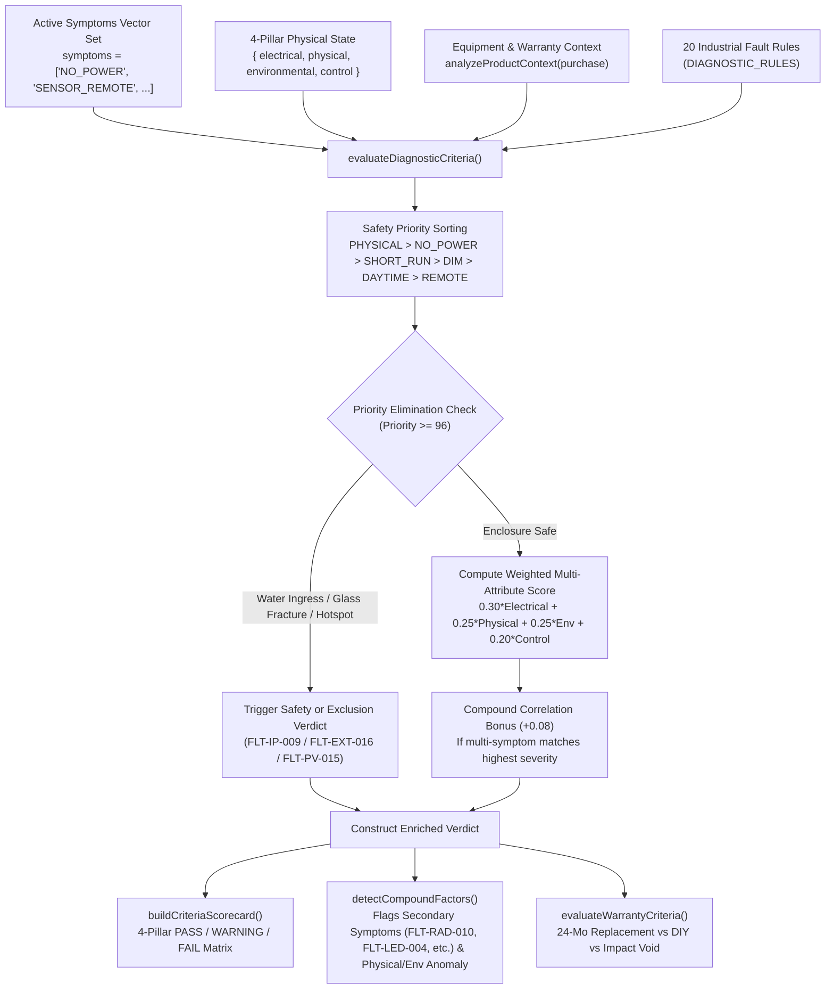

# Solar Multi-Criteria Troubleshooting & Diagnostic Engine: Architecture & Explanation

This document explains the technical architecture, multi-criteria evaluation model, and rule-based inference engine behind the **Customer Troubleshooting & Diagnostic System** in the JD Solar platform, alongside its standalone visualizer in [`docs/interactive_decision_tree.html`](file:///home/ram/Projects/Cross-platform/Solar_App_Capstone_Project/docs/interactive_decision_tree.html).

---

## 1. Why a Multi-Criteria Decision Tree Instead of Static 1-Step Branching?

### The Limitation of 1-Hop Static Trees
In a simple 1-step branching script, selecting a symptom and clicking a single option immediately jumps to a static paragraph. In real industrial solar deployments, hardware failures are **multi-factorial**:
- A luminaire might fail to last through the night because of **heavy road soot (`FLT-PV-005`)** *combined with* **consecutive monsoon days (`FLT-ENV-003`)**.
- A unit with **flickering LEDs** might actually have **moisture condensation inside the optical lens (`FLT-IP-009`)**, which must be caught by a **Physical Seal Elimination Criterion** before advising the user to charge the unit in the sun.
- An **All-in-One Integrated Streetlight** has no external aviation cable plug, whereas a **Split-Type Streetlight** relies on an external waterproof aviation connector.

Therefore, JD Solar implements a **Forward-Chaining Multi-Criteria Rule-Based Expert System** that evaluates **four weighted criteria pillars** across a **3-Stage Progressive Hardware Audit** (or via a **Direct Multi-Criteria Matrix**).

---

## 2. The 4 Weighted Diagnostic Criteria Pillars (Sum = 1.00)

Every diagnostic evaluation assesses four objective hardware dimensions before rendering a verdict:

| Criterion Pillar | Weight | Evaluated Parameters | Engineering Role |
| :--- | :--- | :--- | :--- |
| **1. Electrical Continuity** | **30%** (`0.30`) | Midday charging LED state, open/closed loop continuity, LED driver regulation, photocell voltage threshold (`5.0V`). | Distinguishes PV open-circuit / connector faults from internal battery or controller failures. |
| **2. Physical & IP Seal** | **25%** (`0.25`) | IP65/IP67 gasket integrity, optical lens condensation, tempered glass state, cell thermal hotspots, bracket torque. | Acts as a **Priority Elimination Criterion**: water ingress (`FLT-IP-009`) or glass impact fracture (`FLT-EXT-016`) overrides normal runtime tests. |
| **3. Environmental Exposure** | **25%** (`0.25`) | Monsoon / 72-hour cloud cover, road dust / exhaust soiling, midday tree/eave micro-shading, tilt & South azimuth. | Separates zero-defect seasonal irradiance deficits (`FLT-ENV-003`) from genuine hardware defects. |
| **4. Control & Lifecycle** | **20%** (`0.20`) | Master waterproof switch state, IR remote / microwave radar duty cycle, service age (<24 mos vs 2+ years). | Identifies out-of-the-box switch disengagement, radar eco-dimming, or LiFePO4 cycle aging (`FLT-BAT-008`). |

---

## 3. Dual-Mode Diagnostic Architecture

### Code Implementation
- **Multi-Criteria Engine & Rule Base**: [`frontend/src/lib/solarDiagnosticEngine.js`](file:///home/ram/Projects/Cross-platform/Solar_App_Capstone_Project/frontend/src/lib/solarDiagnosticEngine.js)
- **Diagnostic Modal & Criteria Matrix UI**: [`frontend/src/components/FaultDiagnosticModal.jsx`](file:///home/ram/Projects/Cross-platform/Solar_App_Capstone_Project/frontend/src/components/FaultDiagnosticModal.jsx)
- **Standalone Monochrome Visualizer**: [`docs/interactive_decision_tree.html`](file:///home/ram/Projects/Cross-platform/Solar_App_Capstone_Project/docs/interactive_decision_tree.html)
- **Structural Reference Map**: [`docs/diagnostic_decision_tree_reference.md`](file:///home/ram/Projects/Cross-platform/Solar_App_Capstone_Project/docs/diagnostic_decision_tree_reference.md)

Both the production React modal and the standalone HTML visualizer provide **two synchronized operating modes**:

### Mode A: Guided 3-Stage Multi-Criteria Audit
1. **Stage 0 — Multi-Choice Symptom Intake & Priority Branching (`ROOT`)**:
   - Inspects the registered unit's form factor (`INTEGRATED_AIO` vs `SPLIT_MODULAR`) and warranty status (`24-Month Active` vs `Expired`).
   - Allows selecting **one or multiple concurrent symptoms** (1 to 6).
   - Executes **Priority-Weighted Automatic Branching**: automatically routes questions through the highest-severity symptom (`Physical Damage/Heat` > `No Power` > `Short Runtime` > `Dim/Flicker` > `Daytime On` > `Sensor/Remote`), while storing all selected symptoms in `criteriaState.symptoms` as active compound factors.
2. **Stage 1 — Criterion 1: Electrical & Charging Continuity (`30%` Weight)**:
   - Evaluates the daytime charging indicator LED, LED array pattern, or photocell voltage threshold.
3. **Stage 2 — Criterion 2: Physical & IP65 Enclosure Inspection (`25%` Weight)**:
   - Verifies whether the optical lens is dry and sealed, whether the aviation plug is seated, or whether condensation, cell hotspots, or glass fractures are present.
4. **Stage 3 — Criteria 3 & 4: Environmental Exposure & Service Lifecycle (`45%` Combined Weight)**:
   - Captures 72-hour weather history, shading/soiling, tilt angle, and unit age, then fires **`EVALUATE_CRITERIA`**.
5. **Stage 4 — Multi-Criteria Rule Inference Verdict**:
   - Outputs the matched Fault Code (`FLT-PV-001` through `FLT-SNS-020`), **Rule Match Confidence (`86%–99%`)**, **4-Pillar Pass/Warning/Fail Scorecard**, **Compound Contributing Hardware Factors (including secondary symptoms)**, **Inferred Telemetry**, and **Warranty Qualification Verdict**.

### Mode B: Direct Multi-Criteria Matrix Evaluator
- Exposes all criteria vectors (`symptoms` array, `electrical`, `physical`, `environmental`, `control`) in an interactive specification grid.
- Allows toggling multiple symptoms simultaneously, showing which symptom is designated `[PRIMARY]` (highest severity) and which are `[COMPOUND]`.
- Recalculates the composite weighted rule match, compound factors, and warranty status via `evaluateDiagnosticCriteria()` in real time.

---

## 4. Algorithmic Flow of `evaluateDiagnosticCriteria()`

---

## 5. Free-Text Multi-Clue Extraction (`matchDiagnosticFreeText`)

When a customer types a natural description into the input bar (in English or Tagalog), [`matchDiagnosticFreeText()`](file:///home/ram/Projects/Cross-platform/Solar_App_Capstone_Project/frontend/src/lib/solarDiagnosticEngine.js) parses tokens across all 5 criteria dimensions simultaneously:
- If the user types a **multi-clue compound description** (e.g., *"water droplets inside lens and flickering during rain"* or *"died after 2 hours and panel has thick dust"*), the parser extracts multiple criteria vectors at once (`clueCount >= 2`) and immediately executes `evaluateDiagnosticCriteria()` to return the full scorecard.
- If the user types a **single symptom** (e.g., *"ayaw bumukas sa gabi"* / *"won't turn on"*), it routes them into Stage 1 of that symptom's 3-step criteria audit with the symptom pre-populated.

---

## 6. Capstone Presentation & Defense Talking Points

1. **"How is this an actual Rule-Based / Multi-Criteria System rather than a static FAQ?"**
   - *Answer:* Each diagnostic path collects a 5-attribute state vector (`symptom`, `electrical`, `physical`, `environmental`, `control`) weighted by engineering criticality (`30%`, `25%`, `25%`, `20%`). The inference engine (`evaluateDiagnosticCriteria`) evaluates all 20 rules in `DIAGNOSTIC_RULES`, applies priority elimination rules for safety hazards, detects compound secondary faults (`detectCompoundFactors`), and outputs an explainable 4-pillar Pass/Warning/Fail scorecard.
2. **"Why not use an external generative AI API for troubleshooting?"**
   - *Answer:* Standalone solar street lights contain high-discharge LiFePO4 battery packs and sealed IP65 enclosures. Generative LLMs can hallucinate unsafe instructions (such as opening sealed battery housings, which voids warranty and risks short-circuit). A deterministic multi-criteria inference engine guarantees 100% manufacturer-compliant, reproducible diagnostics.
3. **"How does the diagnostic engine integrate with the Warranty Claims board?"**
   - *Answer:* When a hardware fault meets the warranty criteria, clicking **Transfer Criteria to Warranty Claim** serializes the Fault Code, Rule Confidence, 4-Pillar Criteria Scorecard, Compound Factors, and Inferred Telemetry directly into the technician intake ticket.
