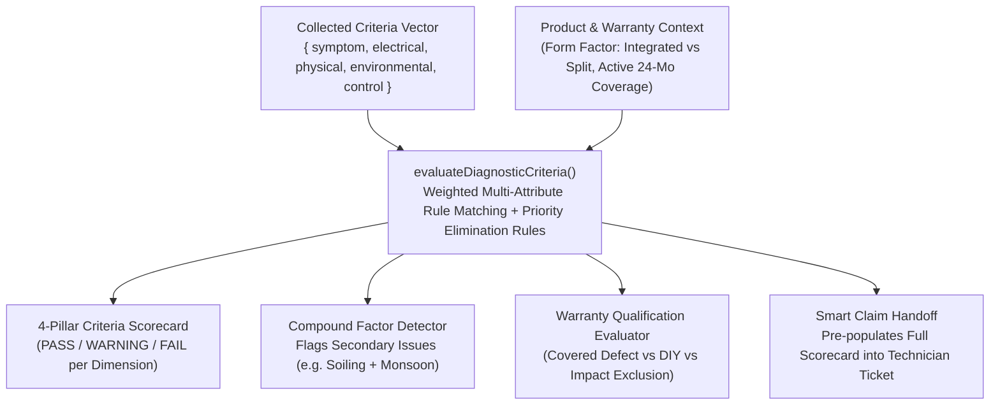

# Solar Multi-Criteria Troubleshooting & Diagnostic Engine: Architecture & Explanation

This document explains the technical architecture, multi-criteria evaluation model, and rule-based inference engine behind the **Customer Troubleshooting & Diagnostic System** in the JD Solar platform.

---

## 1. Why Multi-Criteria Rule-Based Inference Instead of Static Branching?

Standalone off-grid solar equipment (streetlights, floodlights, commercial yard lights) has **no Wi-Fi, no Bluetooth, and no remote IoT telemetry**. Hardware fault isolation must therefore evaluate observable physical, electrical, and environmental conditions.

Rather than relying on a shallow 1-step multiple-choice script or an unpredictable generative AI that could hallucinate unsafe battery instructions, JD Solar implements a **Forward-Chaining Multi-Criteria Rule-Based Expert System**.

### The 4 Weighted Diagnostic Criteria Pillars (Sum = 1.00)

Every hardware audit evaluates four objective criteria dimensions before rendering a verdict:

| Criterion Pillar | Weight | Evaluated Parameters | Engineering Purpose |
| :--- | :--- | :--- | :--- |
| **1. Electrical Continuity** | **30%** (`0.30`) | Midday charging LED state, open/closed loop continuity, LED driver regulation, photocell voltage threshold. | Distinguishes PV open-circuit / connector faults from internal battery or controller failures. |
| **2. Physical & IP Seal** | **25%** (`0.25`) | IP65/IP67 gasket integrity, optical lens condensation, tempered glass state, cell thermal hotspots, bracket torque. | Acts as an **elimination criterion**: water ingress (`FLT-IP-009`) or glass impact fracture (`FLT-EXT-016`) takes priority over standard runtime tests. |
| **3. Environmental Exposure** | **25%** (`0.25`) | Monsoon / 72-hour cloud cover, road dust / exhaust soiling, midday tree/eave micro-shading, tilt & South azimuth. | Separates zero-defect seasonal irradiance deficits (`FLT-ENV-003`) from genuine hardware defects. |
| **4. Control & Lifecycle** | **20%** (`0.20`) | Master waterproof switch state, IR remote / microwave radar duty cycle, service age (<24 mos vs 2+ years). | Identifies out-of-the-box switch disengagement, radar eco-dimming, or LiFePO4 cycle aging (`FLT-BAT-008`). |

---

## 2. Dual-Mode Diagnostic Architecture

### Code Implementation
- **Multi-Criteria Engine & Rule Base**: [`frontend/src/lib/solarDiagnosticEngine.js`](file:///home/ram/Projects/Cross-platform/Solar_App_Capstone_Project/frontend/src/lib/solarDiagnosticEngine.js)
- **Diagnostic Modal & Criteria Matrix UI**: [`frontend/src/components/FaultDiagnosticModal.jsx`](file:///home/ram/Projects/Cross-platform/Solar_App_Capstone_Project/frontend/src/components/FaultDiagnosticModal.jsx)
- **Customer Portal Integration**: [`frontend/src/pages/CustomerPortalPage.jsx`](file:///home/ram/Projects/Cross-platform/Solar_App_Capstone_Project/frontend/src/pages/CustomerPortalPage.jsx)

The user interface inside [`FaultDiagnosticModal.jsx`](file:///home/ram/Projects/Cross-platform/Solar_App_Capstone_Project/frontend/src/components/FaultDiagnosticModal.jsx) provides two synchronized modes:

1. **Guided Multi-Criteria Audit (3-Stage Progressive Triage)**
   - **Stage 0 (Symptom Selection)**: Identifies the primary failure mode (`NO_POWER`, `SHORT_RUNTIME`, `DIM_FLICKER`, `DAYTIME_ON`, `PHYSICAL_HOTSPOT`, `SENSOR_REMOTE`).
   - **Stage 1 (Electrical Continuity Check — 30%)**: Collects daytime charging LED and circuit behavior.
   - **Stage 2 (Physical & Enclosure Check — 25%)**: Verifies IP65 lens seal, glass integrity, and connector seating (adapting automatically between *All-in-One Integrated* and *Split-Type Modular* luminaires).
   - **Stage 3 (Environmental & Control Context — 45%)**: Evaluates recent weather, shading/soiling, and service age, then triggers `evaluateDiagnosticCriteria()`.
   - **Simulated AI Streaming**: Responses stream sentence-by-sentence via `splitIntoSentenceSegments()` for an organic consultative experience.

2. **Direct Multi-Criteria Matrix Evaluator**
   - Allows the customer or technician to directly configure all 5 state attributes (`symptom`, `electrical`, `physical`, `environmental`, `control`) in an interactive matrix and observe real-time rule inference, confidence scoring, and warranty eligibility.

---

## 3. Multi-Criteria Rule Inference & Compound Factor Detection

### Key Capabilities of `evaluateDiagnosticCriteria()`
- **Weighted Rule Scoring**: Matches observed criteria against all 20 industrial fault rules (`DIAGNOSTIC_RULES`), weighting each criterion by its pillar weight (`0.30`, `0.25`, `0.25`, `0.20`).
- **Priority Elimination Rules**: Critical physical conditions such as internal moisture ingress (`FLT-IP-009`), shattered tempered glass (`FLT-EXT-016`), or cell thermal hotspots (`FLT-PV-015`) carry priority weights to immediately alert the user to safety or exclusion conditions.
- **Compound Factor Detection (`detectCompoundFactors`)**: Real-world solar issues often involve multiple simultaneous factors (for example, a loose aviation plug *plus* heavy road soot on the glass). Instead of discarding secondary observations, the engine surfaces a **Compound Contributing Criteria** alert alongside the primary verdict.
- **Automated Warranty Criteria Evaluation (`evaluateWarrantyCriteria`)**: Cross-references the diagnosed fault code and physical glass/seal state against the registered purchase's 24-month warranty status to determine whether the unit qualifies for the **1-Time Replacement Entitlement**, is a **Zero-Defect / DIY Maintenance** item, or is **Disqualified due to External Impact**.
