# Solar Troubleshooting & Diagnostic Engine: Architecture & Explanation

This document explains the technical architecture, decision-tree structure, and domain principles behind the **Customer Troubleshooting & Diagnostic Assistant** in the JD Solar platform.

---

## 1. What Is the Troubleshooting Engine? (In Plain English)

### Why Isn't It an "Unpredictable AI"?
Standalone solar equipment (streetlights, floodlights, commercial yard lights) has **no Wi-Fi, no Bluetooth, and no SIM card**. The computer cannot ping the light to see its battery health.

Therefore, troubleshooting must rely on **observable physical symptoms**:
- Does the little indicator blink under the sun?
- Does the light die after 2 hours?
- Is there condensation inside the glass?

Instead of using a generative AI that might invent fake solar advice or hallucinate repair steps, the troubleshooting system is a **Deterministic Rule-Based Expert Decision Tree (Rule-Based Expert System)**.

---

## 2. Is It a Tree? How the Architecture Works

**Yes, it is literally a directed graph / decision tree!**

In computer science, this is an **Expert Diagnostic Decision Tree**:
1. **Root Node**: The broad observed symptom (What is broken?).
2. **Branch Nodes (Triage Questions)**: Narrowing down physical clues (What does the indicator LED do? What is the weather?).
3. **Leaf Nodes (Verdicts & Telemetry)**: Specific fault diagnosis, severity rating, DIY remedy steps, or warranty claim recommendations.

### Code Implementation
- **Data Model & Decision Tree**: [`frontend/src/lib/solarDiagnosticEngine.js`](file:///home/ram/Projects/Cross-platform/Solar_App_Capstone_Project/frontend/src/lib/solarDiagnosticEngine.js)
- **UI Modal Component**: [`frontend/src/components/FaultDiagnosticModal.jsx`](file:///home/ram/Projects/Cross-platform/Solar_App_Capstone_Project/frontend/src/components/FaultDiagnosticModal.jsx)
- **Customer Portal Entry Point**: [`frontend/src/pages/CustomerPortalPage.jsx`](file:///home/ram/Projects/Cross-platform/Solar_App_Capstone_Project/frontend/src/pages/CustomerPortalPage.jsx) (Triggered via "Troubleshoot" or "Run Troubleshooting Guide" button on a purchased product).

---

## 3. Visual Diagram of the Diagnostic Tree

```mermaid
graph TD
    ROOT["ROOT: Customer Selects Main Observed Symptom"]

    %% Branches
    ROOT --> B1["SYMPTOM_NO_POWER<br>Light Does NOT Turn On"]
    ROOT --> B2["SYMPTOM_SHORT_RUNTIME<br>Shuts Off in 1-3 Hours"]
    ROOT --> B3["SYMPTOM_DIM_FLICKER<br>Dim or Flickering LEDs"]
    ROOT --> B4["SYMPTOM_DAYTIME_ON<br>Stays ON in Bright Sun"]
    ROOT --> B5["SYMPTOM_PHYSICAL_HOTSPOT<br>Heat / Glass / Bracket"]
    ROOT --> B6["SYMPTOM_SENSOR_REMOTE<br>Sensor / Remote No Response"]

    %% Branch 1 Outcomes
    B1 --> D1A["DIAG_OPEN_CIRCUIT<br>FLT-PV-001: Loose Aviation Plug (DIY Fix)"]
    B1 --> D1B["DIAG_BMS_LOCKOUT<br>FLT-BAT-002: BMS Low-Voltage Cutoff (Sun-Soak)"]
    B1 --> D1C["DIAG_RAIN_DEPLETION<br>FLT-ENV-003: 3 Stormy Days (Zero Defect)"]
    B1 --> D1D["DIAG_SWITCH_DISENGAGED<br>Master Switch OFF (DIY Fix)"]

    %% Branch 2 Outcomes
    B2 --> D2A["DIAG_SOILING_LOSS<br>FLT-PV-004: Dust / Soot on Glass (Wipe Clean)"]
    B2 --> D2B["DIAG_SHADING_LOSS<br>FLT-PV-005: Tree / Roof Shadow (Trim / Relocate)"]
    B2 --> D2C["DIAG_TILT_MISALIGNMENT<br>FLT-PV-006: Wrong Tilt / Flat (Angle 10-15° South)"]
    B2 --> D2D["DIAG_BATTERY_AGING<br>FLT-BAT-007: Battery Worn Out (Warranty Claim)"]

    %% Branch 3 Outcomes
    B3 --> D3A["DIAG_WATER_INGRESS<br>FLT-IP-008: Water Inside Lens (Warranty Claim)"]
    B3 --> D3B["DIAG_NORMAL_RADAR<br>Normal Radar Motion Dimming (Normal Behavior)"]
    B3 --> D3C["DIAG_VOLTAGE_RIPPLE<br>LED Driver Ripple (Shop Repair)"]
    B3 --> D3D["DIAG_LED_ARRAY_BURNOUT<br>SMD LED Burnout (Warranty Claim)"]

    %% Seamless Handoff
    D1A --> CLAIM["Handoff to Warranty Claim Form<br>(Pre-populates Fault Code, Telemetry & Notes)"]
    D2D --> CLAIM
    D3A --> CLAIM
```



---

## 4. How the Customer Uses It on the Portal Page

On [`CustomerPortalPage.jsx`](file:///home/ram/Projects/Cross-platform/Solar_App_Capstone_Project/frontend/src/pages/CustomerPortalPage.jsx):

1. **Product Identification**: The customer clicks **"Troubleshoot"** next to their registered purchase (e.g. *Integrated Solar Street Light 100W*).
2. **Guided Decision Path**:
   - The modal pops up and displays the product name and wattage.
   - It prompts with 6 core symptom categories.
3. **Step-by-Step Triage**:
   - Customer picks: *"Light Does NOT Turn On at Night"*.
   - Engine asks: *"During sunny midday hours, what does the small charging indicator LED do?"*
   - Customer picks: *"Indicator LED is completely dark"*.
4. **Instant Technical Verdict**:
   - The engine reaches leaf node `DIAG_OPEN_CIRCUIT` (`FLT-PV-001`).
   - Displays severity: `Mild • DIY Fixable`.
   - Explains the issue: *The solar panel aviation plug has loosened or disconnected.*
   - Gives clear DIY steps: Inspect the waterproof screw collar, align the guide notch, and tighten clockwise.
5. **Smart Warranty Handoff (`transferToClaim`)**:
   - If the user tries the fix and reports *"Cable Damaged: File Warranty Claim"*, the engine clicks over to the **Warranty Claim Form Tab**.
   - It **automatically pre-populates** the technician report with:
     - Exact Fault Code (`FLT-PV-001`)
     - Severity and confidence percentage
     - Telemetry estimates (0.0V open circuit, seal inspection)
     - Complete diagnostic history so the shop technician doesn't make the customer repeat the story.

---

## 5. Free-Text Keyword Matching (Natural Language Fallback)

What if the customer types in the chat box instead of clicking buttons?

In [`solarDiagnosticEngine.js`](file:///home/ram/Projects/Cross-platform/Solar_App_Capstone_Project/frontend/src/lib/solarDiagnosticEngine.js), the function `matchDiagnosticFreeText(query, product)` runs deterministic keyword token matching:

```javascript
// Example from solarDiagnosticEngine.js
if (['dead', 'off', 'wont turn on', 'dark', 'blackout', 'no light'].some(k => q.includes(k))) {
  return DIAGNOSTIC_TREE.SYMPTOM_NO_POWER;
}
if (['die', 'early', 'short', 'few hours', 'shut off', 'drain', '1 hour', '2 hours'].some(k => q.includes(k))) {
  return DIAGNOSTIC_TREE.SYMPTOM_SHORT_RUNTIME;
}
if (['dim', 'flicker', 'blink', 'half', 'weak', 'strobe', 'water', 'condens'].some(k => q.includes(k))) {
  return DIAGNOSTIC_TREE.SYMPTOM_DIM_FLICKER;
}
```

- If they type *"my light died after 2 hours"*, it matches `short` / `2 hours` and routes them straight to the **Short Runtime Triage Branch**!
- If no keyword matches, it returns to the main diagnostic menu safely without crashing.

---

## 6. How to Explain This in Your Capstone Presentation

When defending or presenting this feature to panelists or professors:

1. **"Why not use an external LLM API like ChatGPT?"**
   - *Answer:* Solar luminaires are closed physical systems without network telemetry. An LLM can hallucinate false advice (like telling a user to open a sealed IP67 battery enclosure, which voids warranty and risks chemical fire). Our system uses a **Deterministic Rule-Based Expert Decision Tree**, ensuring $100\%$ consistent, manufacturer-compliant triage.

2. **"What is the underlying data structure?"**
   - *Answer:* It is a **Directed Decision Graph** where each node contains prompt copy, conditional choices (`options`), child node pointers (`next`), and leaf nodes containing standardized diagnostic fault codes (`FLT-PV-001`, `FLT-BAT-002`), severities, and DIY remediation steps.

3. **"How does it reduce company costs and customer friction?"**
   - *Answer:* Over $60\%$ of solar light returns are caused by simple user issues (loose aviation plug, tree shade, or 3 days of rain). The diagnostic assistant resolves these instantly via DIY triage, saving unnecessary transport to Quiapo/Cavite service centers. For genuine hardware defects, it pre-populates a structured technical claim report for the technician.
